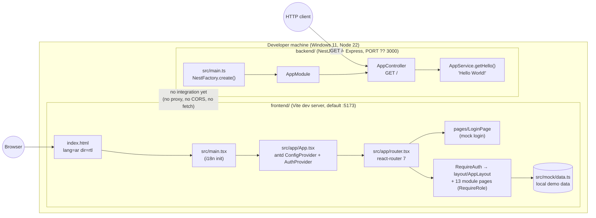
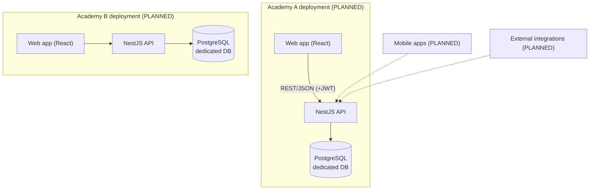
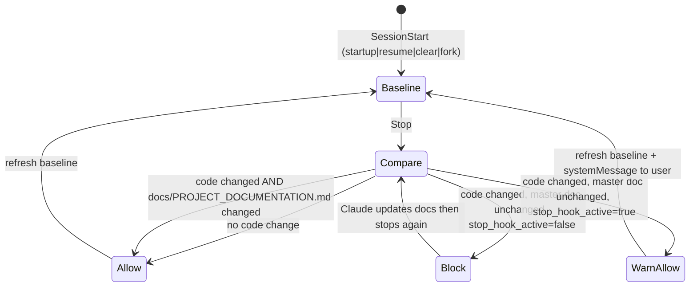

# ArtiCode Academy — التوثيق التقني الرئيسي (Master Project Documentation)

| البند | القيمة |
|---|---|
| **إصدار الوثيقة** | 1.1.0 |
| **تاريخ آخر مزامنة مع الكود** | 2026-10-29 14:46 (UTC+03:00) |
| **آخر معرّف تغيير مسجّل** | CH-0005 |
| **مرحلة المشروع الحالية** | Stage 1 — Foundation (جارية): المستودع تحت Git (CH-0004)، وهيكل واجهة منتج تجريبي ببيانات محلية (CH-0005). الخادم ما زال هيكلاً بلا منطق أعمال |
| **المالك التقني للوثيقة** | فريق تطوير ArtiCode Academy (يُحدَّث بواسطة المطورين و Claude Code وفق `CLAUDE.md`) |
| **اللغة** | عربية مهنية مع الإبقاء على المعرّفات التقنية والأسماء البرمجية بالإنجليزية |

> **قاعدة ذهبية:** هذه الوثيقة هي **المرجع التقني الوحيد المعتمد** للمشروع. كل ما فيها إمّا مُستند إلى دليل من الكود الفعلي، أو موسوم صراحةً بأحد الوسوم التالية:
>
> | الوسم | المعنى |
> |---|---|
> | `IMPLEMENTED` | منفّذ فعلياً ويوجد دليل في الكود |
> | `PARTIALLY_IMPLEMENTED` | منفّذ جزئياً |
> | `PLANNED` | مخطَّط له ولم يُنفَّذ بعد |
> | `DEPRECATED` | مهمَل وسيُزال |
> | `REMOVED` | أُزيل من الكود (مع الإبقاء على سجله التاريخي) |
> | `UNVERIFIED` | لم يتسنَّ التحقق منه من الكود أو من البيئة |
> | `NOT YET DETERMINED` | قرار أو معلومة لم تُحسم بعد |
>
> أي معلومة عن ميزة مستقبلية مأخوذة من **موجز مالك المشروع بتاريخ 2026-10-28** تُعامل كـ *متطلب* وليس كـ *تنفيذ*.

---

## فهرس المحتويات

- [01. PROJECT OVERVIEW — نظرة عامة على المشروع](#01-project-overview--نظرة-عامة-على-المشروع)
- [02. PRODUCT REQUIREMENTS — متطلبات المنتج](#02-product-requirements--متطلبات-المنتج)
- [03. TECHNOLOGY STACK — الحزمة التقنية](#03-technology-stack--الحزمة-التقنية)
- [04. PROJECT STRUCTURE — هيكل المشروع](#04-project-structure--هيكل-المشروع)
- [05. SYSTEM ARCHITECTURE — معمارية النظام](#05-system-architecture--معمارية-النظام)
- [06. DATABASE DOCUMENTATION — توثيق قاعدة البيانات](#06-database-documentation--توثيق-قاعدة-البيانات)
- [07. USER ROLES AND PERMISSIONS — الأدوار والصلاحيات](#07-user-roles-and-permissions--الأدوار-والصلاحيات)
- [08. SYSTEM MODULES — وحدات النظام](#08-system-modules--وحدات-النظام)
- [09. USER WORKFLOWS — رحلات المستخدم](#09-user-workflows--رحلات-المستخدم)
- [10. API DOCUMENTATION — توثيق واجهات البرمجة](#10-api-documentation--توثيق-واجهات-البرمجة)
- [11. CONFIGURATION AND ENVIRONMENT — الإعداد والبيئة](#11-configuration-and-environment--الإعداد-والبيئة)
- [12. SECURITY ARCHITECTURE — المعمارية الأمنية](#12-security-architecture--المعمارية-الأمنية)
- [13. TESTING AND QUALITY ASSURANCE — الاختبار وضمان الجودة](#13-testing-and-quality-assurance--الاختبار-وضمان-الجودة)
- [14. DEPLOYMENT AND OPERATIONS — النشر والتشغيل](#14-deployment-and-operations--النشر-والتشغيل)
- [15. FEATURE STATUS MATRIX — مصفوفة حالة الميزات](#15-feature-status-matrix--مصفوفة-حالة-الميزات)
- [16. KNOWN ISSUES AND TECHNICAL DEBT — المشكلات المعروفة والدين التقني](#16-known-issues-and-technical-debt--المشكلات-المعروفة-والدين-التقني)
- [17. ARCHITECTURAL DECISION LOG — سجل القرارات المعمارية](#17-architectural-decision-log--سجل-القرارات-المعمارية)
- [18. DEVELOPMENT ROADMAP — خارطة طريق التطوير](#18-development-roadmap--خارطة-طريق-التطوير)
- [19. PROJECT CHANGE HISTORY — سجل تغييرات المشروع](#19-project-change-history--سجل-تغييرات-المشروع)
- [20. DOCUMENTATION MAINTENANCE — صيانة التوثيق](#20-documentation-maintenance--صيانة-التوثيق)
- [الملحق A — اصطلاحات المعرّفات](#الملحق-a--اصطلاحات-المعرّفات)
- [الملحق B — سجل التحقق من الكود](#الملحق-b--سجل-التحقق-من-الكود)

---

## 01. PROJECT OVERVIEW — نظرة عامة على المشروع

### 1.1 اسم المشروع

**ArtiCode Academy** — منصة شاملة لإدارة الأكاديميات والتعلّم.

### 1.2 الغرض والأهداف التجارية

وفق موجز مالك المشروع (2026-10-28)، يهدف المنتج إلى تمكين الأكاديميات التعليمية من إدارة كامل دورة حياتها التشغيلية والأكاديمية في منصة واحدة:

- إدارة الأكاديمية والمستخدمين (معلمون، طلاب، أولياء أمور، موظفون).
- إدارة المحتوى التعليمي (دورات، مستويات، فصول، مجموعات، دروس مباشرة ومسجّلة).
- الجدولة والتقويم.
- التقييم (واجبات، اختبارات، درجات، شهادات، سجلات أكاديمية).
- الإدارة المالية (مدفوعات، أقساط، متابعة مالية).
- الإشعارات والتقارير.
- أدوار وصلاحيات مخصّصة، ودعم تعدد اللغات.

### 1.3 الجمهور المستهدف

| الفئة | الوصف | الحالة |
|---|---|---|
| مالكو/مديرو الأكاديميات | يديرون نشر الأكاديمية وإعداداتها ومستخدميها | PLANNED |
| المعلمون | يديرون الدروس والتقييمات | PLANNED |
| الطلاب | يتابعون الدروس ويؤدون الواجبات والاختبارات | PLANNED |
| أولياء الأمور | يتابعون تقدّم الطلاب والمدفوعات | PLANNED |
| الموظفون الإداريون | يدعمون العمليات اليومية (تسجيل، مالية، دعم) | PLANNED |

### 1.4 المشكلات التي يحلّها المنتج (الرؤية)

- تشتّت أدوات الأكاديميات بين أنظمة متعددة (جدولة، تقييم، مالية، تواصل).
- الحاجة إلى عزل بيانات كل أكاديمية (نشر مستقل وقاعدة بيانات مخصّصة لكل أكاديمية).
- الحاجة إلى صلاحيات مرنة تناسب هياكل إدارية مختلفة.
- دعم اللغة العربية ولغات أخرى في واجهة واحدة.

### 1.5 رؤية المنتج ونطاق النظام (PLANNED)

- نشر مستقل لكل أكاديمية (Independent academy deployments).
- قاعدة بيانات مخصّصة لكل أكاديمية (Dedicated database per academy).
- تكاملات مستقبلية وتطبيقات محمولة.
- قابلية التوسّع والصيانة على المدى الطويل.

### 1.6 مرحلة التطوير الحالية — ما هو موجود فعلاً (حالة الكود بتاريخ 2026-10-29)

| العنصر | الحالة الفعلية |
|---|---|
| `backend/` | هيكل **NestJS 12** مولَّد بأداة `@nestjs/cli`، يحتوي على وحدة واحدة (`AppModule`) ونقطة نهاية واحدة `GET /` تُعيد النص `Hello World!`. لا توجد قاعدة بيانات ولا مصادقة ولا أي منطق أعمال. الاعتماديات مثبّتة مع `package-lock.json` منذ CH-0003، والاختبارات والبناء ناجحة. |
| `frontend/` | تطبيق **Vite 8 + React 19 + TypeScript 7** مع **Ant Design 6** و**react-router 7** و**i18next** (CH-0005): دخول تجريبي، تخطيط عام (قائمة جانبية + ترويسة)، 13 شاشة وحدة ببيانات محلية ثنائية اللغة، عربية افتراضياً مع RTL. **لا اتصال بالخادم ولا بيانات حقيقية** — نموذج أولي للمعاينة (MOD-FE-01). |
| قاعدة البيانات | **غير موجودة.** لا ORM، لا ترحيلات (migrations)، لا إعدادات اتصال. |
| المصادقة والصلاحيات | **غير موجودة في الخادم.** في الواجهة مصادقة تجريبية (أي بيانات تُقبل) وبوابات أدوار للعرض فقط (KI-017). |
| التكامل بين الواجهة والخادم | **غير موجود.** لا proxy في Vite ولا CORS في NestJS؛ الواجهة تقرأ من `frontend/src/mock/data.ts`. |
| نظام الإصدارات | **تحت Git منذ CH-0004** (فرع `main`، commit الأساس `127cb1d`). لا remote ولا سياسة فروع بعد. |
| التوثيق | قبل هذه الوثيقة: ملفا README افتراضيان من الأطر فقط. |
| نظام التوثيق المستمر | `IMPLEMENTED` بتاريخ 2026-10-28: هذه الوثيقة + `CLAUDE.md` + خطّاف تحقق (`.claude/hooks/doc-sync-check.mjs`). |

**الخلاصة:** الخادم ما زال في **المرحلة 0 (Scaffold)**؛ المشروع ككل دخل **المرحلة 1 (Foundation)** جزئياً: Git مُفعّل، وهيكل واجهة تجريبي يسمح بمعاينة شاشات المنتج. كل ميزات الرؤية المذكورة أعلاه `PLANNED` ما لم يُذكر خلاف ذلك (التفصيل في [القسم 15](#15-feature-status-matrix--مصفوفة-حالة-الميزات)).

---

## 02. PRODUCT REQUIREMENTS — متطلبات المنتج

> مصدر هذه المتطلبات: موجز مالك المشروع بتاريخ 2026-10-28. وُسمت كلٌّ منها بـ **CONFIRMED-REQUIREMENT** (مطلب مؤكد من المالك) أو **RECOMMENDED** (توصية هندسية من فريق التوثيق تحتاج إلى اعتماد). لا يوجد أي منها منفّذاً حالياً.

### 2.1 القدرات الجوهرية للمنتج (Core capabilities)

| المعرّف | القدرة | النوع | الحالة |
|---|---|---|---|
| REQ-01 | نشر مستقل لكل أكاديمية | CONFIRMED-REQUIREMENT | PLANNED |
| REQ-02 | قاعدة بيانات مخصّصة لكل أكاديمية | CONFIRMED-REQUIREMENT | PLANNED |
| REQ-03 | إدارة الأكاديمية (إعدادات، هوية، فروع إن وُجدت) | CONFIRMED-REQUIREMENT | PLANNED |
| REQ-04 | إدارة المستخدمين: معلمون، طلاب، أولياء أمور، موظفون | CONFIRMED-REQUIREMENT | PLANNED |
| REQ-05 | الدورات والمستويات والفصول والمجموعات | CONFIRMED-REQUIREMENT | PLANNED |
| REQ-06 | الدروس المباشرة والمسجّلة | CONFIRMED-REQUIREMENT | PLANNED |
| REQ-07 | الجداول الزمنية والجدولة | CONFIRMED-REQUIREMENT | PLANNED |
| REQ-08 | الواجبات والاختبارات والدرجات | CONFIRMED-REQUIREMENT | PLANNED |
| REQ-09 | الشهادات والسجلات الأكاديمية | CONFIRMED-REQUIREMENT | PLANNED |
| REQ-10 | المدفوعات والأقساط والمتابعة المالية | CONFIRMED-REQUIREMENT | PLANNED |
| REQ-11 | الإشعارات والتقارير | CONFIRMED-REQUIREMENT | PLANNED |
| REQ-12 | أدوار وصلاحيات مخصّصة | CONFIRMED-REQUIREMENT | PLANNED |
| REQ-13 | دعم تعدد اللغات | CONFIRMED-REQUIREMENT | PLANNED |
| REQ-14 | تكاملات مستقبلية وتطبيقات محمولة | CONFIRMED-REQUIREMENT | PLANNED |

### 2.2 متطلبات إدارة الأكاديمية

- إنشاء أكاديمية وتهيئتها بقاعدة بيانات خاصة (REQ-01, REQ-02).
- إدارة هوية الأكاديمية وإعداداتها العامة (REQ-03).
- إدارة الهيكل التنظيمي والأدوار (REQ-12).

### 2.3 المتطلبات الوظيفية (Functional)

مستمدّة من REQ-03 إلى REQ-14. تفاصيل كل وحدة في [القسم 08](#08-system-modules--وحدات-النظام). **لم تُكتب بعد قصص مستخدم أو معايير قبول تفصيلية** — `NOT YET DETERMINED`.

### 2.4 المتطلبات غير الوظيفية (Non-functional)

| المعرّف | المتطلب | النوع | ملاحظات |
|---|---|---|---|
| NFR-01 | قابلية التوسّع والصيانة طويلة الأمد | CONFIRMED-REQUIREMENT | يُترجم عملياً إلى معمارية وحدات (NestJS modules) وتوثيق مستمر |
| NFR-02 | عزل بيانات كل أكاديمية | CONFIRMED-REQUIREMENT | انظر ADR-008 |
| NFR-03 | أهداف أداء قابلة للقياس (زمن استجابة، تزامن) | RECOMMENDED | لم تُحدَّد أرقام — `NOT YET DETERMINED` |
| NFR-04 | توفّر وتعافٍ من الكوارث (نسخ احتياطي لكل قاعدة بيانات) | RECOMMENDED | `NOT YET DETERMINED` |
| NFR-05 | أمان: مصادقة قوية، تشفير كلمات المرور، تحقق من المدخلات، سجلات تدقيق | RECOMMENDED | انظر [القسم 12](#12-security-architecture--المعمارية-الأمنية) |
| NFR-06 | إمكانية الوصول (Accessibility) وفق WCAG | RECOMMENDED | المستوى المستهدف `NOT YET DETERMINED` |
| NFR-07 | تعدد اللغات مع دعم الاتجاه من اليمين لليسار (RTL) للعربية | CONFIRMED-REQUIREMENT (اللغات) / RECOMMENDED (RTL) | الواجهة: ar (افتراضي، RTL) + en منذ CH-0005 (ADR-010). الخادم: بلا i18n |
| NFR-08 | قابلية الاختبار (اختبارات وحدة وتكامل وشاملة) | RECOMMENDED | الأطر موجودة (Vitest) بلا اختبارات ذات معنى بعد |

### 2.5 متطلبات قابلية التوسّع والأداء

- نموذج النشر المستقل لكل أكاديمية يعني أن التوسّع أفقيٌّ على مستوى الأكاديمية، لا على مستوى مستأجرين متعددين في قاعدة واحدة (PLANNED، انظر ADR-008).
- لا توجد قياسات أداء حالية (لا يوجد ما يُقاس) — `UNVERIFIED`.

### 2.6 إمكانية الوصول وتعدد اللغات

- الواجهة: بنية i18n منفّذة منذ CH-0005 (`frontend/src/i18n/*`): العربية افتراضياً مع `dir="rtl"`، والإنجليزية ثانوية، مع تبديل فوري وحفظ الاختيار محلياً (ADR-010). الخادم: لا i18n — `PLANNED`.
- إمكانية الوصول: لا فحص WCAG بعد. مكوّنات Ant Design توفّر أساساً (ARIA) لكن المستوى الفعلي `UNVERIFIED`.

---

## 03. TECHNOLOGY STACK — الحزمة التقنية

### 3.1 الخادم (Backend) — `backend/`

الإصدارات المثبّتة مأخوذة من `backend/package-lock.json` (lockfileVersion 3) الذي أُنشئ في CH-0003 بتاريخ 2026-10-28.

| التقنية | الإصدار المعلَن في `package.json` | الإصدار المثبّت فعلياً | الدور |
|---|---|---|---|
| Node.js | غير معلَن (لا يوجد حقل `engines`) | **v22.20.0** على جهاز التطوير | بيئة التشغيل. بعض أدوات التطوير تطلب 22.22.3 أو أحدث (KI-012) |
| TypeScript | `^6.0.2` | **6.0.3** | لغة البرمجة |
| NestJS `@nestjs/core` | `^12.0.1` | **12.3.2** | إطار الخادم |
| `@nestjs/common` | `^12.0.1` | **12.3.2** | الديكوريتورات والأدوات المشتركة |
| `@nestjs/platform-express` | `^12.0.1` | **12.3.2** | محوّل HTTP، ويعتمد على Express **5.3.0** |
| `reflect-metadata` | `^0.2.2` | **0.2.2** | دعم الديكوريتورات |
| `rxjs` | `^7.8.1` | **7.8.2** | تدفقات تفاعلية (اعتمادية NestJS) |
| `@nestjs/cli` | `^12.0.0` (dev) | **12.0.11** | أوامر `nest build/start` |
| `@nestjs/schematics` | `^12.0.0` (dev) | **12.0.0** | توليد الوحدات |
| `@nestjs/testing` | `^12.0.1` (dev) | **12.3.2** | أدوات الاختبار |
| `@nestjs/mau` | `^0.2.6` (dev) | **0.2.9** | أداة نشر Mau (AWS). جاءت مع الهيكل وغير مستخدمة، وهي مصدر كل ثغرات `npm audit` (KI-011) |
| Vitest | `^4.1.2` (dev) | **4.1.12** | إطار الاختبار (وحدة + e2e) |
| `@vitest/coverage-v8` | `^4.1.2` (dev) | **4.1.12** | تغطية الاختبارات |
| `supertest` / `@types/supertest` | `^7.0.0` (dev) | **7.3.1** (supertest) | اختبارات HTTP الشاملة |
| `vite-tsconfig-paths` | `^5.1.4` (dev) | **5.1.4** | حلّ مسارات tsconfig داخل Vitest. Vite 8 يدعم ذلك أصلياً ويُظهر تحذيراً (KI-013) |
| oxlint | `^1.58.0` (dev) | **1.90.0** | الفحص الثابت (Linter) |
| Prettier | `^3.4.2` (dev) | **3.9.10** | التنسيق |
| `@types/node` | `^24.0.0` (dev) | **24.19.2** | أنواع Node (لاحظ: أعلى من إصدار التشغيل 22 — KI-008) |
| `@types/express` | `^5.0.0` (dev) | **5.0.6** | أنواع Express |
| `source-map-support` | `^0.5.21` (dev) | مثبّت | خرائط المصدر |

**نمط الوحدات:** ESM (`"type": "module"` في `package.json`، و`module: nodenext` في `tsconfig.json`). لذلك تستخدم الاستيرادات النسبية لاحقة `.js` حتى لملفات `.ts` (مثال: `import { AppModule } from './app.module.js'`).

### 3.2 الواجهة (Frontend) — `frontend/`

| التقنية | الإصدار المعلَن | الإصدار المثبّت (من `package-lock.json`، تم التحقق 2026-10-28؛ الصفوف الخمسة الأخيرة أُضيفت وتحقّقت 2026-10-29) | الدور |
|---|---|---|---|
| React | `^19.3.1` | **19.3.1** | مكتبة الواجهة |
| React DOM | `^19.3.1` | **19.3.1** | التصيير في المتصفح |
| Vite | `^8.3.5` | **8.3.5** | أداة البناء وخادم التطوير |
| TypeScript | `~7.0.2` | **7.0.2** | لغة البرمجة (الإصدار 7 = المنفّذ الأصلي "tsgo") |
| `@vitejs/plugin-react` | `^6.1.2` | **6.1.2** | دعم React/JSX في Vite (يستخدم Oxc) |
| oxlint | `^1.89.0` | **1.90.0** | الفحص الثابت |
| `@types/react` / `@types/react-dom` | `^19.3.0` | **19.3.0** | الأنواع |
| `@types/node` | `^24.19.2` | **24.19.2** | أنواع Node لإعدادات Vite |
| `antd` | `^6.6.8` | **6.6.8** | مكتبة مكوّنات الواجهة؛ RTL عبر `ConfigProvider direction` — أُضيفت في CH-0005 (ADR-009) |
| `@ant-design/icons` | `^6.3.4` | **6.3.4** | أيقونات antd — CH-0005 |
| `react-router` | `^7.18.5` | **7.18.5** | التوجيه في المتصفح؛ مثبّت عمداً على الإصدار الرئيسي 7 (ADR-011) — CH-0005 |
| `i18next` | `^26.5.11` | **26.5.11** | محرك الترجمة — CH-0005 (ADR-010) |
| `react-i18next` | `^17.1.9` | **17.1.9** | ربط i18next بـ React (`useTranslation`) — CH-0005 |

تثبيت الحزم الخمس أضاف 73 حزمة (102 حزمة مدقَّقة، `npm audit`: 0 ثغرات) بتاريخ 2026-10-29.

### 3.3 قاعدة البيانات و ORM

| البند | الحالة |
|---|---|
| محرك قاعدة البيانات | **PostgreSQL** — `PLANNED` (ذُكر في النقاشات المعمارية السابقة وفق موجز المالك؛ لا يوجد أي اعتمادية أو إعداد في الكود) |
| ORM | `NOT YET DETERMINED` (انظر ADR-003) |
| نظام الترحيلات | `NOT YET DETERMINED` |

### 3.4 المصادقة

لا توجد أي مكتبة مصادقة (`@nestjs/passport`, `@nestjs/jwt`, `bcrypt`, …) في الاعتماديات. `PLANNED` — انظر MOD-01.

### 3.5 أدوات الاختبار

- الخادم: Vitest 4 + `@nestjs/testing` + supertest (موجودة في الاعتماديات، مع اختبارين توليديين).
- الواجهة: **لا يوجد** إطار اختبار مثبّت.

### 3.6 النشر

لا توجد أي إعدادات نشر (Dockerfile، CI، إعدادات بيئة). يوجد سكربت `deploy: nest deploy` من هيكل NestJS يستهدف منصة Mau — غير مُستخدم. انظر [القسم 14](#14-deployment-and-operations--النشر-والتشغيل).

### 3.7 الخدمات الخارجية

**لا توجد** أي تكاملات خارجية في الكود.

### 3.8 بيئة التطوير (تم التحقق 2026-10-28)

| الأداة | الإصدار |
|---|---|
| نظام التشغيل | Windows 11 (10.0.26100) |
| Node.js | v22.20.0 |
| npm | 10.9.3 |
| Claude Code (امتداد VS Code) | 2.1.312 |
| Git Bash | متوفر (يُستخدم لتشغيل خطّافات Claude Code) |
| Git | 2.46.2.windows.1 (تم التحقق 2026-10-29، CH-0004) |
| PowerShell | 7+ |

### 3.9 أسباب الخيارات المعمارية المؤكدة

| الخيار | الدليل | السبب المسجَّل |
|---|---|---|
| NestJS على Node.js/TypeScript | `backend/package.json`, `backend/src/*` | ذُكر Node.js و NestJS في النقاشات المعمارية السابقة (موجز المالك). **لا يوجد توثيق داخل المستودع لسبب الاختيار** — انظر ADR-001 |
| React + Vite + TypeScript | `frontend/package.json`, `frontend/vite.config.ts` | **السبب غير مسجَّل** — ADR-002 |
| Vitest بدل Jest | `backend/vitest.config.ts` | هو الافتراضي الذي يولّده `@nestjs/cli` 12؛ **لا دليل على أنه اختيار متعمّد** — ADR-005 |
| oxlint بدل ESLint | `backend/oxlint.json`, `frontend/.oxlintrc.json` | افتراضي قوالب الأطر؛ السبب غير مسجَّل — ADR-006 |

---

## 04. PROJECT STRUCTURE — هيكل المشروع

### 4.1 الشجرة الفعلية بتاريخ 2026-10-29 بدون مجلدات الاعتماديات

```text
ArtiCodeAcademy/
├── .git/                             ← مستودع Git، الفرع main (أُنشئ في CH-0004)
├── .gitignore                        ← تجاهل جذري: node_modules, dist, coverage, *.tsbuildinfo, .env* (CH-0004)
├── .gitattributes                    ← تطبيع نهايات الأسطر إلى LF + وسم الثنائيات (CH-0004)
├── CLAUDE.md                         ← تعليمات التشغيل الدائمة لـ Claude Code (أُضيف في CH-0002)
├── docs/
│   └── PROJECT_DOCUMENTATION.md      ← هذه الوثيقة (المرجع الوحيد المعتمد)
├── .claude/
│   ├── settings.json                 ← إعدادات المشروع لـ Claude Code (خطّافات التحقق من التوثيق)
│   ├── hooks/
│   │   └── doc-sync-check.mjs        ← سكربت التحقق من مزامنة التوثيق (SessionStart + Stop)
│   └── .doc-sync/                    ← حالة الخطّاف (بصمات الملفات لكل جلسة) — متجاهَل بـ .gitignore ذاتي
├── backend/                          ← تطبيق NestJS 12 (ESM)
│   ├── .prettierrc
│   ├── README.md                     ← README الافتراضي لـ NestJS (غير خاص بالمشروع)
│   ├── nest-cli.json
│   ├── oxlint.json
│   ├── package.json
│   ├── package-lock.json             ← lockfileVersion 3 (أُنشئ في CH-0003)
│   ├── tsconfig.json
│   ├── tsconfig.build.json
│   ├── vitest.config.ts              ← اختبارات الوحدة (**/*.spec.ts)
│   ├── vitest.config.e2e.ts          ← الاختبارات الشاملة (**/*.e2e-spec.ts)
│   ├── src/
│   │   ├── main.ts                   ← نقطة الدخول (bootstrap)
│   │   ├── app.module.ts             ← الوحدة الجذرية
│   │   ├── app.controller.ts         ← GET /
│   │   ├── app.service.ts            ← يُعيد "Hello World!"
│   │   └── app.controller.spec.ts    ← اختبار وحدة
│   └── test/
│       └── app.e2e-spec.ts           ← اختبار شامل لـ GET /
└── frontend/                         ← تطبيق Vite 8 + React 19 + Ant Design 6 (هيكل منتج تجريبي منذ CH-0005)
    ├── .gitignore
    ├── .oxlintrc.json
    ├── README.md                     ← README الافتراضي لقالب Vite (غير خاص بالمشروع)
    ├── index.html                    ← lang="ar" dir="rtl"، العنوان "ArtiCode Academy"
    ├── package.json                  ← + antd, @ant-design/icons, react-router@7, i18next, react-i18next
    ├── package-lock.json             ← lockfileVersion 3
    ├── tsconfig.json                 ← مراجع إلى app/node
    ├── tsconfig.app.json
    ├── tsconfig.node.json
    ├── vite.config.ts                ← plugins: [react()] فقط (لا proxy)
    ├── public/
    │   └── favicon.svg               ← أيقونة قالب Vite، لم تُستبدل بعد (KI-019)
    └── src/
        ├── main.tsx                  ← نقطة الدخول: يحمّل ./i18n ثم يصيّر <App /> داخل StrictMode
        ├── index.css                 ← أنماط عامة بالحد الأدنى (ارتفاع كامل، خط النظام)
        ├── app/
        │   ├── App.tsx               ← ConfigProvider (اتجاه + لغة + ثيم antd) → AntdApp → AuthProvider → AppRouter
        │   └── router.tsx            ← createBrowserRouter: /login عام؛ البقية داخل RequireAuth → AppLayout
        ├── auth/                     ← مصادقة تجريبية (mock) تُستبدل بعميل MOD-01
        │   ├── roles.ts              ← ROLES = admin | teacher | student | guardian | staff
        │   ├── auth-context.ts       ← AuthContext + useAuth()
        │   ├── AuthProvider.tsx      ← جلسة تجريبية في localStorage (aca.mockUser)
        │   └── RequireAuth.tsx       ← RequireAuth (→ /login) و RequireRole (بوابة واجهة فقط → 403)
        ├── components/
        │   ├── PageHeader.tsx        ← عنوان + وصف + إجراءات
        │   ├── StatusTag.tsx         ← ألوان مفردات labels.* المشتركة
        │   ├── LanguageSwitcher.tsx  ← العربية / English
        │   └── RoleSwitcher.tsx      ← "عرض كـ" لمعاينة الأدوار
        ├── i18n/
        │   ├── language.ts           ← SUPPORTED_LANGUAGES, directionOf(), نوع LocalizedText
        │   ├── index.ts              ← تهيئة i18next (ar افتراضياً؛ التخزين في localStorage: aca.language)
        │   ├── ar.ts                 ← القاموس المرجعي (يصدّر النوع Translation)
        │   ├── en.ts                 ← مُلزَم بنوع Translation لضمان تطابق المفاتيح
        │   └── useLocalized.ts       ← اختيار النص من LocalizedText حسب اللغة النشطة
        ├── layout/
        │   ├── navigation.ts         ← NAV_ITEMS: المفتاح، المسار، الأيقونة، الأدوار، الوحدة (MOD-xx)
        │   ├── AppLayout.tsx         ← Sider (قائمة حسب الدور) + Header + Content (Outlet)
        │   └── AppLayout.css
        ├── mock/
        │   └── data.ts               ← بيانات تجريبية ثنائية اللغة لكل وحدة (تُحذف عند الربط بالخادم)
        └── pages/
            ├── LoginPage.tsx / LoginPage.css
            ├── DashboardPage.tsx
            ├── UsersPage.tsx, CoursesPage.tsx, ClassesPage.tsx, SchedulePage.tsx
            ├── LessonsPage.tsx, AssignmentsPage.tsx, ExamsPage.tsx, CertificatesPage.tsx
            ├── PaymentsPage.tsx, NotificationsPage.tsx, ReportsPage.tsx, SettingsPage.tsx
            └── NotFoundPage.tsx, ForbiddenPage.tsx
```

أُزيلت في CH-0005: `frontend/src/App.tsx` (قالب)، `frontend/src/App.css`، `frontend/src/assets/{hero.png, react.svg, vite.svg}`، `frontend/public/icons.svg`.

### 4.2 مسؤوليات المجلدات

| المسار | المسؤولية | ملاحظات |
|---|---|---|
| `backend/src/` | كود الخادم المصدري. `nest-cli.json` يحدده كـ `sourceRoot` | المخرجات في `backend/dist/` (تُحذف قبل كل بناء: `deleteOutDir: true`) |
| `backend/test/` | الاختبارات الشاملة (e2e) | مستبعَد من البناء عبر `tsconfig.build.json` |
| `frontend/src/` | كود الواجهة | `tsconfig.app.json` يشمل `src` فقط |
| `frontend/src/app/` | تركيب التطبيق: المزوّدات (`App.tsx`) والموجّه (`router.tsx`) | CH-0005 |
| `frontend/src/auth/` | المصادقة التجريبية، الأدوار، حارسا المسارات | تُستبدل بعميل MOD-01 الحقيقي |
| `frontend/src/components/` | مكوّنات مشتركة صغيرة (رأس صفحة، وسم حالة، مبدّلا اللغة والدور) | |
| `frontend/src/i18n/` | تهيئة i18next، القواميس، أدوات اللغة | إضافة لغة = قاموس جديد + إدخال في `SUPPORTED_LANGUAGES` + ترجمة antd |
| `frontend/src/layout/` | التخطيط العام وتعريف التنقل (`NAV_ITEMS`) | **مصدر الحقيقة** لمسارات الشاشات وأدوارها |
| `frontend/src/mock/` | بيانات تجريبية محلية | **تُحذف** تدريجياً عند ربط كل وحدة بالخادم (ADR-012) |
| `frontend/src/pages/` | شاشة لكل وحدة منتج + 404/403 | ملف واحد لكل شاشة بتصدير مُسمّى |
| `frontend/public/` | أصول ثابتة تُنسخ كما هي | |
| `docs/` | التوثيق المعتمد | ملف واحد حالياً |
| `.claude/` | أدوات Claude Code الخاصة بالمشروع | لا تحتوي على أي كود تطبيق |

### 4.3 نقاط الدخول (Entry points)

| التطبيق | الملف | ما يفعله |
|---|---|---|
| Backend | `backend/src/main.ts` | `NestFactory.create(AppModule)` ثم `app.listen(process.env.PORT ?? 3000)` باستخدام `await` على المستوى الأعلى (ESM) |
| Frontend | `frontend/index.html` → `frontend/src/main.tsx` | يحمّل `./i18n` (تهيئة i18next وضبط `lang`/`dir` على `<html>`) ثم يُنشئ جذر React داخل `<div id="root">` ويصيّر `<App />` من `src/app/App.tsx` داخل `StrictMode` |

### 4.4 ملفات الإعداد ودلالاتها

| الملف | أهم الإعدادات الفعلية |
|---|---|
| `backend/tsconfig.json` | `module: nodenext`, `target: ES2023`, `strict: true`, `strictPropertyInitialization: false`, `emitDecoratorMetadata`, `experimentalDecorators`, `types: ["vitest/globals", "node"]`, `outDir: ./dist`, `incremental: true` |
| `backend/tsconfig.build.json` | يرث السابق، `rootDir: ./src`، يستبعد `test`, `dist`, `**/*spec.ts` |
| `backend/nest-cli.json` | `collection: @nestjs/schematics`, `sourceRoot: src`, `deleteOutDir: true` |
| `backend/vitest.config.ts` | `globals: true`, `include: ['**/*.spec.ts']`, إضافة `vite-tsconfig-paths` |
| `backend/vitest.config.e2e.ts` | نفس السابق مع `include: ['**/*.e2e-spec.ts']` |
| `backend/oxlint.json` | `no-explicit-any: off`, `no-floating-promises: warn`, `env.node: true` |
| `backend/.prettierrc` | `singleQuote: true`, `trailingComma: all` |
| `frontend/vite.config.ts` | `plugins: [react()]` فقط — **لا يوجد proxy للخادم** |
| `frontend/tsconfig.app.json` | `target: es2023`, `moduleResolution: bundler`, `jsx: react-jsx`, `verbatimModuleSyntax`, `erasableSyntaxOnly`, `noUnusedLocals/Parameters`, `noEmit`. **لا يُعلن `strict`** لكن تم التحقق (2026-10-28) أن TypeScript 7.0.2 يطبّق الفحوص الصارمة افتراضياً (`noImplicitAny`, `strictNullChecks` فعّالان) |
| `frontend/tsconfig.node.json` | إعدادات `vite.config.ts` فقط |
| `frontend/.oxlintrc.json` | plugins: `react`, `typescript`, `oxc`؛ `react/rules-of-hooks: error`؛ `react/only-export-components: warn` |
| `frontend/.gitignore` | يتجاهل `node_modules`, `dist`, `*.local`, ملفات المحرّرات (أصبح مغطّى بالجذري، وأُبقي كما ولّده القالب) |
| `.gitignore` (جذري) | `node_modules/`, `dist/`, `dist-ssr/`, `coverage/`, `*.tsbuildinfo`, `.env` و`.env.*` (مع استثناء `.env.example`)، سجلات، `.claude/settings.local.json`، ملفات المحرّرات ونظام التشغيل (CH-0004) |
| `.gitattributes` | `* text=auto eol=lf` لتطبيع نهايات الأسطر، ووسم `png/jpg/gif/ico/woff/woff2` كثنائية (CH-0004) |

### 4.5 الاصطلاحات التطويرية المعتمدة (مستنتجة من الإعدادات الفعلية)

1. **الخادم ESM:** الاستيرادات النسبية تنتهي بـ `.js`.
2. **التنسيق في الخادم:** Prettier مع علامات اقتباس مفردة وفواصل لاحقة. تشغيل: `npm run format`.
3. **الواجهة (اصطلاح فعلي منذ CH-0005، غير مفروض بأداة — KI-004):** بلا فواصل منقوطة، اقتباس مفرد، مسافتان. مكوّن واحد لكل ملف بتصدير مُسمّى (`export function UsersPage`)، والمكوّن الجذري `App` وحده تصدير افتراضي. الخطافات والسياقات والثوابت في ملفات `.ts` منفصلة عن ملفات المكوّنات (لإرضاء `react/only-export-components`). `import type` في سطر مستقل. استيرادات نسبية بلا لاحقة. لا `enum` ولا خصائص مُنشئ (`erasableSyntaxOnly`). كل نص ظاهر عبر `t()`، والبيانات ثنائية اللغة بنوع `LocalizedText`.
4. **الفحص الثابت:** oxlint في كلا التطبيقين (`npm run lint`).
5. **أسماء ملفات NestJS:** `<name>.module.ts`, `<name>.controller.ts`, `<name>.service.ts`, `<name>.spec.ts`, `<name>.e2e-spec.ts` (اصطلاح الإطار ومتّبع في الهيكل الحالي).
6. **التوثيق:** كل تغيير في الكود يستلزم تحديث هذه الوثيقة وفق `CLAUDE.md`.

---

## 05. SYSTEM ARCHITECTURE — معمارية النظام

### 5.1 المعمارية الحالية الفعلية (IMPLEMENTED)

المشروع اليوم عبارة عن **تطبيقين مستقلّين لا يتواصلان**. منذ CH-0005 أصبحت الواجهة تطبيقاً متعدد الصفحات ببيانات محلية، لكنها ما زالت لا تستدعي الخادم:



**تدفق الطلب الوحيد الموجود:**

```mermaid
sequenceDiagram
    participant C as HTTP Client
    participant E as Express (platform-express)
    participant K as AppController
    participant S as AppService
    C->>E: GET /
    E->>K: route match @Controller() @Get()
    K->>S: getHello()
    S-->>K: "Hello World!"
    K-->>E: string
    E-->>C: 200 OK, text/html; charset=utf-8, body "Hello World!"
```

> تم التحقق فعلياً في CH-0003 بتشغيل `node dist/main.js` واستدعاء `GET /` عبر curl. الاستجابة `200` بنوع محتوى `text/html; charset=utf-8` وطول 12 بايت، مع رأس `X-Powered-By: Express` (KI-014).

### 5.2 المعمارية المستهدفة (PLANNED — غير ملزِمة، تصور للتخطيط فقط)



- نموذج النشر المستقل لكل أكاديمية مأخوذ من موجز المالك (REQ-01, REQ-02).
- آلية إدارة النشرات المتعددة (لوحة Super Admin مركزية؟ أم نشر يدوي لكل أكاديمية؟) — `NOT YET DETERMINED` (ADR-008).

### 5.3 التواصل بين الواجهة والخادم

| البند | الحالة |
|---|---|
| بروتوكول | `NOT YET DETERMINED` (الافتراض المعقول: REST/JSON عبر HTTP) |
| CORS في الخادم | غير مفعّل (`NestFactory.create(AppModule)` بلا `enableCors`) |
| Proxy في Vite | غير مُعدّ |
| عميل HTTP في الواجهة | لا يوجد |
| طبقة بيانات الواجهة | بيانات تجريبية محلية (`frontend/src/mock/data.ts`) منذ CH-0005؛ لا استدعاء HTTP واحد (ADR-012) |
| توثيق OpenAPI/Swagger | لا يوجد |

### 5.4 علاقات الوحدات

**الخادم:** وحدة واحدة فقط: `AppModule` → `AppController` → `AppService`. لا توجد اعتماديات بين وحدات لأنه لا توجد وحدات أخرى.

**الواجهة (CH-0005):** `main.tsx` → `app/App.tsx` → `app/router.tsx` → `layout/AppLayout` → `pages/*`. الملف `layout/navigation.ts` هو مصدر الحقيقة للمسارات والأدوار ويستهلكه `AppLayout` (بناء القائمة) و`auth/RequireAuth` (البوابة `canAccess`) بينما يطابقه `router.tsx` يدوياً. `auth/*` لا يعتمد إلا على `layout/navigation.ts` و`pages/ForbiddenPage`. كل الصفحات تعتمد على `mock/data.ts` و`i18n/useLocalized` و`components/*`.

### 5.5 الأنماط المعمارية

| النمط | الحالة | الدليل |
|---|---|---|
| Modular monolith بوحدات NestJS | IMPLEMENTED (بالحد الأدنى) | `AppModule` |
| Controller → Service (حقن الاعتماديات) | IMPLEMENTED | `AppController` يحقن `AppService` عبر المُنشئ |
| Repository / Data access layer | PLANNED | لا يوجد |
| DTO + Validation pipes | PLANNED | لا يوجد `ValidationPipe` ولا `class-validator` |
| Guards / Roles | PLANNED | لا يوجد |
| Configuration module (`@nestjs/config`) | PLANNED | لا يوجد؛ `process.env.PORT` يُقرأ مباشرة في `main.ts` |
| التوجيه في المتصفح (client-side routing) | IMPLEMENTED | `frontend/src/app/router.tsx` (react-router 7، `createBrowserRouter`) |
| i18n + RTL في الواجهة | IMPLEMENTED | `frontend/src/i18n/*`, `frontend/src/app/App.tsx` (`ConfigProvider direction/locale`) |
| بوابة أدوار على مستوى الواجهة (UI gating) | IMPLEMENTED كنموذج — **ليس فرضاً أمنياً** | `frontend/src/auth/RequireAuth.tsx`, `frontend/src/layout/navigation.ts` |
| طبقة بيانات تجريبية (mock-first) | IMPLEMENTED (مؤقت بطبيعته) | `frontend/src/mock/data.ts` (ADR-012) |

### 5.6 الحدود بين المكونات

- الحد الوحيد الفعلي: الواجهة (متصفح) ↔ الخادم (HTTP) — **ولم يُعبَر بعد**.
- الحدود المخطّطة: API ↔ قاعدة بيانات (عبر ORM)، API ↔ خدمات خارجية (دفع، إشعارات، بث).

### 5.7 الاختناقات المحتملة والقيود المؤكدة

| النوع | الوصف | الحالة |
|---|---|---|
| قيد مؤكد | لا يمكن للواجهة استدعاء الخادم من أصل (origin) مختلف بسبب غياب CORS/proxy | IMPLEMENTED-LIMITATION (KI-007) |
| قيد مؤكد | لا يوجد تخزين دائم للبيانات | IMPLEMENTED-LIMITATION |
| اختناق محتمل | نموذج "قاعدة بيانات لكل أكاديمية" يرفع كلفة التشغيل والترحيلات مع تزايد عدد الأكاديميات | RECOMMENDED-ANALYSIS (ADR-008) |
| اختناق محتمل | الدروس المباشرة/المسجلة تحتاج إلى بنية بث وتخزين خارجية | RECOMMENDED-ANALYSIS |

---

## 06. DATABASE DOCUMENTATION — توثيق قاعدة البيانات

### 6.1 الحالة العامة

**لا توجد قاعدة بيانات في المشروع.** تم التحقق (2026-10-28) من:

- عدم وجود أي اعتمادية ORM أو سائق قاعدة بيانات في `backend/package.json` (`typeorm`, `prisma`, `@mikro-orm/*`, `drizzle-orm`, `pg`, `knex`, `sequelize` — كلها غائبة).
- عدم وجود ملفات `*.entity.ts`, `schema.prisma`, مجلدات `migrations/`, أو ملفات `.env`.
- عدم وجود أي إعداد اتصال في `AppModule` أو `main.ts`.

| البند | القيمة |
|---|---|
| محرك قاعدة البيانات | PostgreSQL — `PLANNED` (وفق موجز المالك) |
| معمارية الاتصال | `NOT YET DETERMINED` |
| ORM | `NOT YET DETERMINED` (ADR-003) |
| الجداول/الكيانات الموجودة | **لا شيء** |
| الأعمدة والمفاتيح والعلاقات | **لا شيء** |
| الفهارس والقيود | **لا شيء** |
| الترحيلات | **لا شيء** |
| عزل البيانات | قاعدة بيانات مخصّصة لكل أكاديمية — `PLANNED` (REQ-02) |
| النسخ الاحتياطي والاستعادة | `NOT YET DETERMINED` |

### 6.2 مخطط الكيانات (ER Diagram)

**لا يوجد مخطط ER** لأنه لا توجد كيانات. سيُضاف هنا عند إدخال أول كيان فعلي (انظر RULE 7 في `CLAUDE.md`). **يُمنع** إدراج كيانات تخطيطية هنا كما لو كانت موجودة.

### 6.3 قيود المخطط الحالية

لا ينطبق.

### 6.4 توصيات للتنفيذ المستقبلي (RECOMMENDED — غير معتمدة)

1. اختيار ORM مع نظام ترحيلات صريح (هجرات مُولَّدة تُراجع يدوياً وتُحفظ في المستودع).
2. توحيد اصطلاح التسمية (`snake_case` للجداول والأعمدة، مفاتيح أساسية UUID أو bigint — يُحسم في ADR لاحق).
3. تضمين `academy_id` أو ما يعادله فقط إذا تغيّر قرار العزل إلى قاعدة مشتركة؛ في نموذج "قاعدة لكل أكاديمية" لا حاجة له على مستوى الصفوف.
4. توثيق كل جدول هنا بجدول: الاسم، الأعمدة، الأنواع، المفاتيح، الفهارس، القيود، العلاقات، ملف الكيان، الترحيل المنشئ.

---

## 07. USER ROLES AND PERMISSIONS — الأدوار والصلاحيات

### 7.1 الحالة العامة

**لا توجد أدوار ولا صلاحيات منفّذة في الخادم.** لا `Guards`، لا ديكوريتور `@Roles`، لا جداول أدوار، لا مصادقة. في الواجهة توجد منذ CH-0005 مفاتيح أدوار (`frontend/src/auth/roles.ts`) ومصفوفة دور×شاشة (`frontend/src/layout/navigation.ts`) **للعرض والمعاينة فقط** (MOD-FE-01) — ليست فرضاً أمنياً. كل ما يلي عن الخادم **`PLANNED`** ومصدره موجز المالك مع توصيف مقترح يحتاج إلى اعتماد.

### 7.2 الأدوار المخطّطة

| المعرّف | الدور | المسؤوليات (مقترح — بانتظار التأكيد) | الوحدات المتاحة (مقترح) | الحالة |
|---|---|---|---|---|
| ROLE-01 | Super Admin | إدارة نشرات الأكاديميات، الإعدادات العامة للمنصة، إنشاء أكاديميات ومديريها | كل الوحدات على مستوى المنصة | PLANNED |
| ROLE-02 | Academy Admin | إدارة أكاديمية واحدة: المستخدمون، الدورات، الجداول، المالية، التقارير، الأدوار المخصّصة | كل وحدات الأكاديمية | PLANNED |
| ROLE-03 | Teacher | إدارة فصوله ودروسه وواجباته واختباراته ودرجاته | Courses, Classes, Lessons, Scheduling (قراءة), Assignments, Exams, Grading | PLANNED |
| ROLE-04 | Student | متابعة الدروس، تسليم الواجبات، أداء الاختبارات، الاطلاع على الدرجات والشهادات | Lessons, Assignments, Exams (تنفيذ), Certificates (قراءة), Payments (قراءة ذاتية) | PLANNED |
| ROLE-05 | Guardian | متابعة طلاب مرتبطين به: الحضور، الدرجات، المدفوعات، الإشعارات | قراءة فقط للطلاب المرتبطين + Payments | PLANNED |
| ROLE-06 | Staff | مهام إدارية محددة (تسجيل، تحصيل، دعم) حسب صلاحيات مخصّصة | يُحدَّد بالأدوار المخصّصة | PLANNED |
| ROLE-07 | Custom roles | أدوار يُنشئها Academy Admin بمجموعة صلاحيات مختارة | ديناميكي | PLANNED |

**تمثيل الأدوار في الواجهة (CH-0005، واجهة فقط):** `frontend/src/auth/roles.ts` يعرّف المفاتيح `admin`, `teacher`, `student`, `guardian`, `staff` المقابلة لـ ROLE-02 إلى ROLE-06. ROLE-01 (Super Admin) غائب عمداً لأنه على مستوى المنصة ويتوقف على ADR-008. ROLE-07 غير ممثَّل. مصفوفة الدور×الشاشة المنفّذة في `layout/navigation.ts` مأخوذة من عمود "الوحدات المتاحة (مقترح)" أعلاه وهي **مقترحة وغير معتمدة من المالك** (`UNVERIFIED` كمتطلب):

| الشاشة | admin | teacher | student | guardian | staff |
|---|---|---|---|---|---|
| لوحة التحكم، الجدول الزمني، الإشعارات | ✓ | ✓ | ✓ | ✓ | ✓ |
| المستخدمون | ✓ | | | | ✓ |
| الدورات والمستويات | ✓ | ✓ | ✓ | ✓ | |
| الفصول والمجموعات | ✓ | ✓ | | | ✓ |
| الدروس | ✓ | ✓ | ✓ | | |
| الواجبات، الاختبارات والدرجات | ✓ | ✓ | ✓ | ✓ | |
| الشهادات | ✓ | | ✓ | ✓ | |
| المدفوعات | ✓ | | ✓ | ✓ | ✓ |
| التقارير، الإعدادات | ✓ | | | | |

### 7.3 الإجراءات المسموحة والممنوعة

`NOT YET DETERMINED` — تُحدَّد مصفوفة الصلاحيات (Permission matrix) عند تصميم وحدة الصلاحيات (MOD-01/MOD-03). **يجب** توثيقها هنا جدولاً: الدور × الوحدة × الإجراء (create/read/update/delete/approve…).

### 7.4 آلية فرض الصلاحيات

| الآلية | الحالة |
|---|---|
| مصادقة (JWT/Session) | PLANNED |
| `AuthGuard` + `RolesGuard` في NestJS | PLANNED |
| صلاحيات دقيقة (permission-based بدل role-based فقط) | RECOMMENDED لدعم ROLE-07 |
| فرض على مستوى الواجهة (إخفاء عناصر) | PARTIALLY_IMPLEMENTED (CH-0005): القائمة والمسارات تُرشَّح حسب الدور في `frontend/src/layout/navigation.ts` و`auth/RequireAuth.tsx` (صفحة 403 عند المسار المباشر) — لا يُعتبر فرضاً أمنياً، والدور قابل للتبديل من `RoleSwitcher` |

### 7.5 العلاقة بين الأدوار

تصور مقترح: Super Admin ⊃ Academy Admin ⊃ (Teacher | Staff) ⊃ Student؛ Guardian مرتبط بطلاب محددين وليس جزءاً من التسلسل. `NOT YET DETERMINED` رسمياً.

---

## 08. SYSTEM MODULES — وحدات النظام

### 8.0 ملخص الوحدات

| المعرّف | الوحدة | الحالة | الملفات |
|---|---|---|---|
| MOD-00 | App bootstrap (Backend root) | IMPLEMENTED | `backend/src/main.ts`, `app.module.ts`, `app.controller.ts`, `app.service.ts` |
| MOD-FE-00 | Frontend shell (template) | REMOVED (CH-0005) | — (كانت: `frontend/src/App.tsx`, `App.css`, `assets/*`, `public/icons.svg`) |
| MOD-FE-01 | Frontend application shell (prototype) | IMPLEMENTED (نموذج أولي ببيانات محلية) | `frontend/src/app/*`, `layout/*`, `auth/*`, `components/*`, `i18n/*`, `mock/data.ts`, `pages/*`, `main.tsx`, `index.html` |
| MOD-01 | Authentication | PLANNED (شاشة دخول تجريبية فقط في الواجهة) | — |
| MOD-02 | Academy management | PLANNED | — |
| MOD-03 | User management & roles | PLANNED | — |
| MOD-04 | Courses & levels | PLANNED | — |
| MOD-05 | Classes & groups | PLANNED | — |
| MOD-06 | Lessons (live & recorded) | PLANNED | — |
| MOD-07 | Scheduling & timetables | PLANNED | — |
| MOD-08 | Assignments | PLANNED | — |
| MOD-09 | Exams & grading | PLANNED | — |
| MOD-10 | Certificates & academic records | PLANNED | — |
| MOD-11 | Payments & installments | PLANNED | — |
| MOD-12 | Notifications | PLANNED | — |
| MOD-13 | Reports | PLANNED | — |
| MOD-14 | Settings | PLANNED | — |
| MOD-15 | Integrations & mobile API | PLANNED | — |

### MOD-00 — App bootstrap (Backend root) — `IMPLEMENTED`

| البند | التفاصيل |
|---|---|
| الغرض التجاري | لا يوجد؛ هيكل تشغيلي يثبت أن الخادم يعمل |
| حالة التطوير | IMPLEMENTED (هيكل مولَّد بـ `@nestjs/cli`) |
| الملفات | `backend/src/main.ts`, `backend/src/app.module.ts`, `backend/src/app.controller.ts`, `backend/src/app.service.ts`, `backend/src/app.controller.spec.ts`, `backend/test/app.e2e-spec.ts` |
| الوظيفة الرئيسية | إنشاء تطبيق Nest والاستماع على المنفذ `PORT` (افتراضي 3000)؛ نقطة نهاية `GET /` تُعيد `Hello World!` |
| قواعد الأعمال | لا شيء |
| الكيانات | لا شيء |
| نقاط النهاية | API-001 (`GET /`) |
| الصلاحيات المطلوبة | لا شيء (عام) |
| الاعتماديات | `@nestjs/core`, `@nestjs/common`, `@nestjs/platform-express` |
| قواعد التحقق | لا شيء (لا `ValidationPipe`) |
| القيود الحالية | لا CORS، لا بادئة عامة (`setGlobalPrefix`)، لا إصدار API، لا إيقاف رشيق (`enableShutdownHooks`)، لا تسجيل مخصّص |
| الأخطاء المعروفة | لا شيء |
| التحسينات المستقبلية | إضافة `@nestjs/config` مع تحقق من المتغيرات، `ValidationPipe` عام، CORS، بادئة `/api`، Swagger |

### MOD-FE-00 — Frontend shell (template) — `REMOVED` (CH-0005)

> **سجل تاريخي.** أُزيلت صفحة القالب وأصولها في CH-0005 (`App.tsx`, `App.css`, `assets/hero.png`, `assets/react.svg`, `assets/vite.svg`, `public/icons.svg`) وحلّ محلّها MOD-FE-01. بقي `public/favicon.svg` من القالب (KI-019). الوصف أدناه يصف الحالة قبل الإزالة ويُحتفظ به وفق RULE 9.

| البند | التفاصيل |
|---|---|
| الغرض التجاري | لا يوجد بعد؛ صفحة قالب Vite الافتراضية |
| حالة التطوير | REMOVED في CH-0005 (كانت IMPLEMENTED كقالب؛ لم تكن أي واجهة منتج) |
| الملفات | `frontend/index.html`, `frontend/src/main.tsx`, `frontend/src/App.tsx`, `frontend/src/App.css`, `frontend/src/index.css`, `frontend/public/*`, `frontend/src/assets/*` |
| الوظيفة الرئيسية | عرض صورة بطل (hero) وعدّاد `useState` وروابط إلى توثيق Vite/React وقنوات مجتمع Vite |
| الحالة (state) | `useState` محلي فقط |
| التوجيه | لا يوجد |
| الاتصال بالخادم | لا يوجد |
| i18n / RTL | لا يوجد؛ `lang="en"` |
| القيود | العنوان `<title>frontend</title>`؛ روابط خارجية غير متعلقة بالمنتج (KI-005) |
| التحسينات المستقبلية | إزالة محتوى القالب، إضافة توجيه، طبقة API، i18n مع RTL، نظام تصميم (أُنجز معظمها في MOD-FE-01 عدا طبقة API) |

### MOD-FE-01 — Frontend application shell (prototype) — `IMPLEMENTED` (نموذج أولي ببيانات محلية)

| البند | التفاصيل |
|---|---|
| الغرض التجاري | تمكين المالك من الدخول إلى شاشات المنتج والتنقل بينها ومعاينتها بكل دور قبل بناء الخادم (نهج "الواجهة أولاً ببيانات تجريبية" — ADR-012) |
| حالة التطوير | IMPLEMENTED كهيكل وشاشات تجريبية (CH-0005). **لا اتصال بالخادم، لا بيانات حقيقية، لا مصادقة حقيقية** |
| الملفات | `frontend/index.html`, `frontend/src/main.tsx`, `frontend/src/index.css`, `frontend/src/app/App.tsx`, `frontend/src/app/router.tsx`, `frontend/src/layout/{navigation.ts, AppLayout.tsx, AppLayout.css}`, `frontend/src/auth/{roles.ts, auth-context.ts, AuthProvider.tsx, RequireAuth.tsx}`, `frontend/src/components/{PageHeader, StatusTag, LanguageSwitcher, RoleSwitcher}.tsx`, `frontend/src/i18n/{language.ts, index.ts, ar.ts, en.ts, useLocalized.ts}`, `frontend/src/mock/data.ts`, `frontend/src/pages/*` (16 صفحة + `LoginPage.css`) |
| الوظيفة الرئيسية | (1) دخول تجريبي: أي بريد/كلمة مرور + اختيار دور → جلسة في `localStorage` (`aca.mockUser`)؛ (2) تخطيط عام: قائمة جانبية مُرشَّحة حسب الدور + ترويسة (شارة "بيانات تجريبية"، مبدّل الدور "عرض كـ"، مبدّل اللغة، قائمة المستخدم/خروج)؛ (3) 13 شاشة وحدة ببيانات محلية ثنائية اللغة (جداول، إحصاءات، قوائم، نموذج إعدادات)؛ (4) صفحتا 404 و403 |
| التوجيه | `react-router` 7 (`createBrowserRouter`): `/login` عام؛ `/` وما تحته داخل `RequireAuth` → `AppLayout` (Outlet)؛ كل شاشة داخل `RequireRole(navKey)`. المسارات: `/`, `/users`, `/courses`, `/classes`, `/schedule`, `/lessons`, `/assignments`, `/exams`, `/certificates`, `/payments`, `/notifications`, `/reports`, `/settings`, و`*` → 404 |
| الحالة (state) | React state + Context (`AuthContext`) فقط؛ لا مكتبة إدارة حالة |
| i18n / RTL | `i18next` + `react-i18next`؛ العربية افتراضياً مع `dir="rtl"`، الإنجليزية ثانوية؛ `ConfigProvider` في antd يتلقى `direction` و`locale` (`ar_EG` / `en_US`)؛ الاختيار محفوظ في `localStorage` (`aca.language`)؛ `document.documentElement.lang/dir` يُحدَّثان عند التبديل. قاموس `en` مُلزَم بنوع قاموس `ar` (`Translation`) فيفشل `tsc` عند أي مفتاح ناقص |
| الأدوار (واجهة فقط) | `auth/roles.ts`: `admin, teacher, student, guardian, staff` (ROLE-02..ROLE-06). مصفوفة الدور×الشاشة في `layout/navigation.ts` (انظر 7.2؛ مقترحة وغير معتمدة). `RoleSwitcher` يسمح بالمعاينة بأي دور — أداة نمذجة، ليست حماية (KI-017) |
| الاتصال بالخادم | لا يوجد. كل البيانات من `mock/data.ts` (مستخدمون، دورات، فصول، جدول، دروس، واجبات، اختبارات، شهادات، مدفوعات، إشعارات، تقارير، إعدادات الأكاديمية) |
| الاعتماديات | `antd` 6.6.8، `@ant-design/icons` 6.3.4، `react-router` 7.18.5، `i18next` 26.5.11، `react-i18next` 17.1.9 |
| القيود الحالية | أزرار "إضافة/تسجيل/إنشاء" تعرض رسالة "غير منفّذ"؛ النموذجان الوحيدان (الدخول، الإعدادات) محليان؛ حجم الحزمة الإنتاجية 1,306 kB قبل الضغط (KI-016)؛ لا اختبارات آلية (13.5)؛ favicon قالب Vite (KI-019)؛ العرض المرئي في متصفح لم يُتحقق منه آلياً في الجلسة (الملحق B) |
| الأخطاء المعروفة | لا شيء مرصود |
| التحسينات المستقبلية | طبقة API (FS-031) تستبدل `mock/data.ts` وحدةً وحدة؛ مصادقة حقيقية (MOD-01) تستبدل `AuthProvider`؛ تقسيم الحزمة بالمسارات (`React.lazy`)؛ اختبارات Vitest + Testing Library؛ هوية بصرية (شعار، favicon، ألوان) |

### MOD-01 — Authentication — `PLANNED`

| البند | التفاصيل |
|---|---|
| الغرض | تسجيل الدخول/الخروج، إدارة الجلسات أو الرموز، استعادة كلمة المرور، ربط المستخدم بدوره |
| الملفات | لا شيء |
| الكيانات | `NOT YET DETERMINED` (متوقع: users, credentials/sessions, refresh tokens) |
| نقاط النهاية | لا شيء |
| الاعتماديات المتوقعة | MOD-03 (المستخدمون)، MOD-02 (سياق الأكاديمية) |
| قواعد مقترحة | تجزئة كلمات المرور (bcrypt/argon2)، رموز JWT قصيرة العمر + تحديث، حد لمحاولات الدخول |
| القيود/المخاطر | أي نقطة نهاية تُضاف قبل هذه الوحدة ستكون عامة |
| واجهة تجريبية (CH-0005) | `frontend/src/pages/LoginPage.tsx` + `frontend/src/auth/AuthProvider.tsx` — المسار `/login`؛ أي بريد/كلمة مرور يُقبلان ويُختار الدور للمعاينة. **ليست مصادقة** (KI-017)؛ تُستبدل عند تنفيذ هذه الوحدة |

### MOD-02 — Academy management — `PLANNED`

| البند | التفاصيل |
|---|---|
| الغرض | إنشاء الأكاديمية وتهيئة نشرها وقاعدة بياناتها وإعداداتها وهويتها |
| الكيانات | `NOT YET DETERMINED` (متوقع: academy, academy_settings, branches?) |
| الاعتماديات | ADR-008 (نموذج العزل)، MOD-14 |
| ملاحظة | في نموذج "نشر مستقل" قد تعيش بيانات الأكاديمية في قاعدتها الخاصة، بينما تحتاج لوحة Super Admin إلى سجل مركزي للأكاديميات — `NOT YET DETERMINED` |

### MOD-03 — User management & roles — `PLANNED`

| البند | التفاصيل |
|---|---|
| الغرض | إدارة المستخدمين بأنواعهم (معلم/طالب/ولي أمر/موظف)، الملفات الشخصية، الأدوار والصلاحيات المخصّصة، ربط أولياء الأمور بالطلاب |
| الكيانات | `NOT YET DETERMINED` (متوقع: users, roles, permissions, role_permissions, user_roles, guardian_students) |
| الاعتماديات | MOD-01 |
| واجهة تجريبية (CH-0005) | `frontend/src/pages/UsersPage.tsx` — المسار `/users`؛ جدول ببيانات محلية (`mockUsers`)؛ زر الإضافة يعرض "غير منفّذ". مفاتيح الأدوار في `frontend/src/auth/roles.ts`. لا منطق خادم |

### MOD-04 — Courses & levels — `PLANNED`

| البند | التفاصيل |
|---|---|
| الغرض | تعريف الدورات ومستوياتها ومحتواها ومتطلباتها |
| الكيانات | `NOT YET DETERMINED` (متوقع: courses, levels, course_levels) |
| الاعتماديات | MOD-02, MOD-03 |
| واجهة تجريبية (CH-0005) | `frontend/src/pages/CoursesPage.tsx` — المسار `/courses`؛ جدول (رمز، اسم، مستوى، معلم، طلاب، حالة) من `mockCourses`. لا منطق خادم |

### MOD-05 — Classes & groups — `PLANNED`

| البند | التفاصيل |
|---|---|
| الغرض | إنشاء الفصول/المجموعات لدورة ومستوى محددين، تعيين المعلمين، تسجيل الطلاب |
| الكيانات | `NOT YET DETERMINED` (متوقع: classes, groups, enrollments, class_teachers) |
| الاعتماديات | MOD-03, MOD-04 |
| واجهة تجريبية (CH-0005) | `frontend/src/pages/ClassesPage.tsx` — المسار `/classes`؛ جدول مع شريط إشغال (مسجّلون/سعة) من `mockClasses`. لا منطق خادم |

### MOD-06 — Lessons (live & recorded) — `PLANNED`

| البند | التفاصيل |
|---|---|
| الغرض | الدروس المباشرة (تكامل بث) والمسجلة (تخزين وتشغيل)، الحضور |
| الكيانات | `NOT YET DETERMINED` (متوقع: lessons, lesson_recordings, attendance) |
| الاعتماديات | MOD-05, MOD-07, MOD-15 (مزود بث/تخزين) |
| ملاحظة | مزوّد البث والتخزين `NOT YET DETERMINED` |
| واجهة تجريبية (CH-0005) | `frontend/src/pages/LessonsPage.tsx` — المسار `/lessons`؛ جدول (عنوان، دورة، نوع مباشر/مسجّل، تاريخ، مدة، حالة) من `mockLessons`. لا تشغيل فيديو ولا بث |

### MOD-07 — Scheduling & timetables — `PLANNED`

| البند | التفاصيل |
|---|---|
| الغرض | الجداول الزمنية للفصول والمعلمين والقاعات، كشف التعارضات |
| الكيانات | `NOT YET DETERMINED` (متوقع: timetables, time_slots, rooms?) |
| الاعتماديات | MOD-05 |
| واجهة تجريبية (CH-0005) | `frontend/src/pages/SchedulePage.tsx` — المسار `/schedule`؛ جدول أسبوعي مرتّب باليوم ثم الوقت من `mockSchedule`. لا كشف تعارضات |

### MOD-08 — Assignments — `PLANNED`

| البند | التفاصيل |
|---|---|
| الغرض | إنشاء الواجبات، التسليم، التصحيح، التغذية الراجعة |
| الكيانات | `NOT YET DETERMINED` (متوقع: assignments, submissions, submission_files) |
| الاعتماديات | MOD-05, MOD-09 (الدرجات) |
| واجهة تجريبية (CH-0005) | `frontend/src/pages/AssignmentsPage.tsx` — المسار `/assignments`؛ جدول (عنوان، دورة، آخر موعد، تسليمات، حالة) من `mockAssignments`. لا تسليم ولا تصحيح |

### MOD-09 — Exams & grading — `PLANNED`

| البند | التفاصيل |
|---|---|
| الغرض | بنوك الأسئلة، إنشاء الاختبارات، الأداء، التصحيح الآلي/اليدوي، احتساب الدرجات النهائية |
| الكيانات | `NOT YET DETERMINED` (متوقع: exams, questions, exam_attempts, answers, grades, grade_schemes) |
| قواعد الأعمال | معادلات احتساب الدرجات `NOT YET DETERMINED` |
| الاعتماديات | MOD-05, MOD-08 |
| واجهة تجريبية (CH-0005) | `frontend/src/pages/ExamsPage.tsx` — المسار `/exams`؛ جدول (عنوان، دورة، تاريخ، مدة، درجة كاملة، متوسط، حالة) من `mockExams`. لا أداء اختبار ولا تصحيح |

### MOD-10 — Certificates & academic records — `PLANNED`

| البند | التفاصيل |
|---|---|
| الغرض | إصدار الشهادات (قوالب، ترقيم، تحقق)، السجل الأكاديمي للطالب |
| الكيانات | `NOT YET DETERMINED` (متوقع: certificates, certificate_templates, academic_records) |
| الاعتماديات | MOD-09 |
| واجهة تجريبية (CH-0005) | `frontend/src/pages/CertificatesPage.tsx` — المسار `/certificates`؛ جدول (رقم تسلسلي، طالب، دورة، تاريخ إصدار، تقدير) من `mockCertificates`. لا إصدار ولا تحقق |

### MOD-11 — Payments & installments — `PLANNED`

| البند | التفاصيل |
|---|---|
| الغرض | الرسوم، خطط الأقساط، تسجيل المدفوعات، الأرصدة، الإيصالات، التكامل مع بوابات دفع |
| الكيانات | `NOT YET DETERMINED` (متوقع: fees, invoices, installments, payments, receipts) |
| الاعتماديات | MOD-03, MOD-05, MOD-15 |
| ملاحظة | بوابة الدفع والعملات `NOT YET DETERMINED` |
| واجهة تجريبية (CH-0005) | `frontend/src/pages/PaymentsPage.tsx` — المسار `/payments`؛ إحصاءا "المحصّل/المتبقي" وجدول فواتير من `mockPayments` (العملة التجريبية `SAR` من `mockAcademySettings`). لا تسجيل دفعات ولا بوابة |

### MOD-12 — Notifications — `PLANNED`

| البند | التفاصيل |
|---|---|
| الغرض | إشعارات داخل التطبيق وبريد/رسائل/دفع (push) للأحداث المهمة |
| الكيانات | `NOT YET DETERMINED` (متوقع: notifications, notification_preferences) |
| الاعتماديات | MOD-03, MOD-15 (مزودي البريد/الرسائل) |
| واجهة تجريبية (CH-0005) | `frontend/src/pages/NotificationsPage.tsx` — المسار `/notifications`؛ قائمة مع مؤشر غير مقروء ووسم القناة وزر "تعيين الكل كمقروء" (حالة محلية فقط) من `mockNotifications`. لا إرسال |

### MOD-13 — Reports — `PLANNED`

| البند | التفاصيل |
|---|---|
| الغرض | تقارير أكاديمية ومالية وتشغيلية قابلة للتصدير |
| الاعتماديات | معظم الوحدات |
| واجهة تجريبية (CH-0005) | `frontend/src/pages/ReportsPage.tsx` — المسار `/reports`؛ بطاقات التقارير المتاحة من `mockReports`؛ زر "إنشاء التقرير" يعرض "غير منفّذ". لا توليد ولا تصدير |

### MOD-14 — Settings — `PLANNED`

| البند | التفاصيل |
|---|---|
| الغرض | إعدادات الأكاديمية والنظام، اللغة الافتراضية، المنطقة الزمنية، العملة، العلامة التجارية |
| الاعتماديات | MOD-02 |
| واجهة تجريبية (CH-0005) | `frontend/src/pages/SettingsPage.tsx` — المسار `/settings`؛ نموذج (اسم الأكاديمية عربي/إنجليزي، اللغة الافتراضية، المنطقة الزمنية، العملة) بقيم `mockAcademySettings`؛ "حفظ" يعرض رسالة نجاح محلية ولا يرسل شيئاً |

### MOD-15 — Integrations & mobile API — `PLANNED`

| البند | التفاصيل |
|---|---|
| الغرض | واجهات للتطبيقات المحمولة، تكاملات خارجية (بث، دفع، بريد، تخزين) |
| ملاحظة | لا تكاملات حالياً؛ قائمة المزودين `NOT YET DETERMINED` |

---

## 09. USER WORKFLOWS — رحلات المستخدم

**لا توجد أي رحلة مستخدم تشغيلية حالياً.** الرحلة الوحيدة القابلة للتنفيذ على الخادم هي: تشغيله واستدعاء `GET /` (تقنية وليست رحلة منتج).

منذ CH-0005 توجد في الواجهة رحلة **معاينة** (ليست رحلة منتج لأنها لا تلمس الخادم ولا بيانات حقيقية): `/login` (أي بيانات + اختيار دور) → `/` لوحة التحكم → التنقل بين شاشات الوحدات حسب الدور → تبديل الدور أو اللغة من الترويسة → تسجيل الخروج. تُوثَّق كرحلة منتج (WF-02 وما بعدها) عند ربطها بالمصادقة الحقيقية (MOD-01).

| المعرّف | الرحلة | الحالة | الوحدات المعنية | ملاحظات |
|---|---|---|---|---|
| WF-01 | إنشاء أكاديمية | PLANNED | MOD-02, MOD-14, MOD-01 | يشمل تهيئة قاعدة بيانات مخصّصة |
| WF-02 | تسجيل مستخدم | PLANNED | MOD-01, MOD-03 | دعوة من المدير أو تسجيل ذاتي — `NOT YET DETERMINED` |
| WF-03 | تعيين معلم لفصل | PLANNED | MOD-03, MOD-05 | |
| WF-04 | تسجيل طالب في دورة/فصل | PLANNED | MOD-03, MOD-05, MOD-11 | قد يرتبط بخطة دفع |
| WF-05 | إنشاء دورة ومستوياتها | PLANNED | MOD-04 | |
| WF-06 | جدولة درس | PLANNED | MOD-06, MOD-07 | كشف التعارضات |
| WF-07 | إنشاء اختبار وأداؤه | PLANNED | MOD-09 | |
| WF-08 | احتساب الدرجات | PLANNED | MOD-08, MOD-09 | المعادلة `NOT YET DETERMINED` |
| WF-09 | إصدار شهادة | PLANNED | MOD-10 | |
| WF-10 | تسجيل دفعة/قسط | PLANNED | MOD-11 | |

عند تنفيذ أي رحلة، يُوثَّق هنا: الخطوات، الأدوار، نقاط النهاية المستدعاة، الكيانات المتأثرة، حالات الفشل.

---

## 10. API DOCUMENTATION — توثيق واجهات البرمجة

### 10.1 الإعدادات العامة لواجهة البرمجة (الحالة الفعلية)

| البند | القيمة |
|---|---|
| العنوان الأساسي | `http://localhost:${PORT:-3000}` |
| بادئة عامة | لا يوجد |
| إصدار API | لا يوجد |
| المصادقة | لا يوجد |
| تنسيق الأخطاء | افتراضي NestJS، لم يُخصَّص. مثال متحقق منه لمسار غير موجود: `404` مع `{"message":"Cannot GET /nope","error":"Not Found","statusCode":404}` |
| OpenAPI/Swagger | لا يوجد |

### 10.2 نقاط النهاية الموجودة فعلاً

#### API-001 — `GET /` — `IMPLEMENTED`

| البند | القيمة |
|---|---|
| الطريقة | `GET` |
| المسار | `/` |
| الغرض | نقطة نهاية الهيكل الافتراضية؛ تُثبت أن الخادم يعمل |
| المصادقة | غير مطلوبة |
| الصلاحيات | لا شيء |
| معاملات الطلب | لا شيء |
| جسم الطلب | لا شيء |
| الاستجابة | `200`، `Content-Type: text/html; charset=utf-8`، الجسم `Hello World!` (متحقق منه في CH-0003) |
| سلوك الأخطاء | لا توجد حالات خطأ متوقعة |
| المتحكم/الخدمة | `AppController.getHello()` → `AppService.getHello()` (`backend/src/app.controller.ts`, `backend/src/app.service.ts`) |
| الاختبارات | `backend/src/app.controller.spec.ts` (وحدة)، `backend/test/app.e2e-spec.ts` (شامل). كلاهما ناجح في CH-0003 |

### 10.3 نقاط النهاية المخطّطة

لا تُوثَّق نقاط نهاية مخطّطة هنا حتى تُنفَّذ (RULE 13 و RULE 14). تُسجَّل عند التنفيذ بالصيغة أعلاه مع معرّف `API-nnn` متسلسل.

---

## 11. CONFIGURATION AND ENVIRONMENT — الإعداد والبيئة

### 11.1 البرمجيات المطلوبة

| البرنامج | الإصدار الموصى به | ملاحظة |
|---|---|---|
| Node.js | 22.22.3 أو أحدث، أو 24.15 أو أحدث | يعمل المشروع على 22.20.0، لكن أدوات `@nestjs/cli` تطلب 22.22.3 أو أحدث وتُظهر تحذيرات `EBADENGINE` (KI-012). لا يوجد حقل `engines` (KI-008) |
| npm | 11.x موصى به للخادم | npm 10.9.3 يتعطل عند `npm install` بدون ملف قفل (KI-015). بعد وجود ملف القفل يعمل `npm ci` مع npm 10 |
| Git + Git Bash | أي إصدار حديث | مطلوب لخطّافات Claude Code على Windows |
| PostgreSQL | — | `PLANNED`؛ غير مطلوب حالياً |

### 11.2 التثبيت

```bash
# الخادم: التثبيت من ملف القفل الموجود (يعمل مع npm 10 و 11)
cd backend
npm ci

# الخادم: إضافة أو تحديث اعتماديات (npm 10 يتعطل هنا، استخدم npm 11)
npx -y npm@11 install <package>

# الواجهة (يحترم package-lock.json الموجود)
cd frontend
npm ci

# الواجهة: إضافة اعتماديات (npm 10 يعمل هنا بلا مشكلة — تم التحقق في CH-0005)
npm install <package>
```

> **تنبيه:** كل أمر يجب تشغيله من داخل مجلد التطبيق الصحيح. أوامر `test` و`test:e2e` و`start:dev` موجودة في `backend/` فقط، وتشغيلها من `frontend/` يعطي `Missing script`.

### 11.3 متغيرات البيئة

| المعرّف | الاسم | الإلزامية | الافتراضي | أين تُقرأ | الوصف |
|---|---|---|---|---|---|
| ENV-01 | `PORT` | اختياري | `3000` | `backend/src/main.ts` | منفذ استماع الخادم |

- لا توجد ملفات `.env` أو `.env.example` في المستودع.
- لا توجد متغيرات بيئة في الواجهة (لا `VITE_*`).
- مفاتيح `localStorage` في الواجهة (ليست متغيرات بيئة، لكنها حالة محلية موثّقة منذ CH-0005): `aca.language` (اللغة المختارة: `ar` أو `en`)، `aca.mockUser` (الجلسة التجريبية — KI-017).
- **لا تُسجَّل أبداً قيم سرية في هذه الوثيقة** (RULE 16). تُسجَّل الأسماء والأوصاف فقط.

### 11.4 إعداد قاعدة البيانات

لا يوجد. عند إضافته تُوثَّق المتغيرات (مثل `DATABASE_URL` أو مكوناتها) بالاسم فقط.

### 11.5 أوامر التطوير

**الخادم (`backend/`):**

| الأمر | ما يفعله |
|---|---|
| `npm run start` | `nest start` — تشغيل عادي |
| `npm run start:dev` | `nest start --watch` — مع إعادة التحميل |
| `npm run start:debug` | `nest start --debug --watch` |
| `npm run start:prod` | `node dist/main` — يتطلب بناءً مسبقاً |
| `npm run build` | `nest build` → `dist/` |
| `npm run lint` | `oxlint src/ test/` |
| `npm run format` | `prettier --write "src/**/*.ts" "test/**/*.ts"` |
| `npm run test` | `vitest run` — اختبارات الوحدة (`**/*.spec.ts`) |
| `npm run test:watch` | `vitest` |
| `npm run test:cov` | `vitest run --coverage` |
| `npm run test:debug` | `vitest --inspect-brk --no-file-parallelism` |
| `npm run test:e2e` | `vitest run --config ./vitest.config.e2e.ts` |
| `npm run deploy` | `nest deploy` (Mau) — غير مُعدّ وغير مستخدم |

**الواجهة (`frontend/`):**

| الأمر | ما يفعله | حالة التحقق (2026-10-28) |
|---|---|---|
| `npm run dev` | خادم Vite للتطوير (افتراضياً `http://localhost:5173`، وينتقل تلقائياً إلى المنفذ التالي إن كان مشغولاً) | شغّله المستخدم بنجاح في 2026-10-28 على `5175` لأن `5173` و`5174` كانا مشغولين |
| `npm run build` | `tsc -b && vite build` → `dist/` | `tsc -b` نجح بلا أخطاء؛ `vite build` لم يُشغَّل |
| `npm run lint` | `oxlint` | نجح بلا تحذيرات |
| `npm run preview` | معاينة مخرجات البناء | لم يُشغَّل |

### 11.6 البناء والنشر

انظر [القسم 14](#14-deployment-and-operations--النشر-والتشغيل). لا يوجد إعداد نشر.

---

## 12. SECURITY ARCHITECTURE — المعمارية الأمنية

### 12.1 الحمايات المؤكدة في الكود (CONFIRMED)

| الحماية | الحالة | الدليل |
|---|---|---|
| TypeScript strict في الخادم | IMPLEMENTED | `backend/tsconfig.json` → `strict: true` |
| فحوص TypeScript صارمة في الواجهة | IMPLEMENTED (افتراضياً) | تم التحقق أن TS 7.0.2 يفرض `noImplicitAny` و`strictNullChecks` بلا إعلان صريح |
| `react/rules-of-hooks` كخطأ | IMPLEMENTED | `frontend/.oxlintrc.json` |
| عدم وجود أسرار في المستودع | CONFIRMED | لا ملفات `.env`؛ المتغير الوحيد `PORT` |

**لا توجد أي حماية أمنية تطبيقية أخرى.** الخادم يقدّم نقطة نهاية عامة واحدة بلا بيانات حساسة.

### 12.2 الفجوات الحالية (مؤكدة من الكود) والتوصيات

| المجال | الحالة الفعلية | التوصية (RECOMMENDED) | الأولوية |
|---|---|---|---|
| المصادقة | غير موجودة | JWT (وصول قصير + تحديث) أو جلسات؛ `@nestjs/passport` | عالية قبل أي بيانات حقيقية |
| التفويض | غير موجود | `RolesGuard` + صلاحيات دقيقة؛ فرض على مستوى الخدمة لا المتحكم فقط | عالية |
| مصادقة الواجهة (CH-0005) | تجريبية: أي بيانات تُقبل، الجلسة والدور في `localStorage` (`frontend/src/auth/AuthProvider.tsx`) | تُستبدل بعميل MOD-01 (رمز JWT قصير العمر في الذاكرة + تحديث)؛ **لا تُعتبر حماية** (KI-017) | عالية قبل أي بيانات حقيقية |
| تفويض الواجهة (CH-0005) | إخفاء الشاشات حسب الدور فقط (`RequireRole`, `navigation.ts`) | الفرض الحقيقي في الخادم؛ الواجهة تبقى طبقة تجربة مستخدم فقط | — |
| كلمات المرور | غير موجودة | argon2id أو bcrypt بكلفة مناسبة؛ سياسة قوة؛ لا تُسجَّل في السجلات | عالية |
| التحقق من المدخلات | لا `ValidationPipe` | `ValidationPipe({ whitelist: true, forbidNonWhitelisted: true, transform: true })` + `class-validator` | عالية |
| CORS | غير مفعّل (يمنع الواجهة من الاتصال) | `enableCors` بقائمة أصول مسموحة من الإعدادات | متوسطة |
| رؤوس الأمان | لا شيء | `helmet` | متوسطة |
| تحديد المعدل | لا شيء | `@nestjs/throttler` خاصة على مسارات الدخول | متوسطة |
| عزل البيانات | لا بيانات | قاعدة لكل أكاديمية (ADR-008)؛ منع أي استعلام عابر للأكاديميات | عالية عند التنفيذ |
| التعامل مع المعلومات الحساسة | لا شيء | تشفير الحقول الحساسة عند الحاجة؛ إخفاء في السجلات | متوسطة |
| سجلات التدقيق | لا شيء | جدول `audit_logs` للأحداث الحساسة (دخول، صلاحيات، مالية، درجات) | متوسطة |
| الإعداد الآمن | `process.env` مباشرة | `@nestjs/config` مع مخطط تحقق (Joi/zod) وفشل مبكر | متوسطة |
| الاعتماديات | ملف قفل موجود منذ CH-0003. `npm audit` يُظهر 5 ثغرات كلها عبر `@nestjs/mau` غير المستخدمة (KI-011) | إزالة `@nestjs/mau` وتشغيل `npm audit` دورياً | متوسطة |
| رأس `X-Powered-By` | Express يرسل `X-Powered-By: Express` (متحقق منه) | تعطيله أو استخدام `helmet` (KI-014) | منخفضة |

### 12.3 المخاطر الأمنية المرصودة في الكود الحالي

| المعرّف | الخطر | الشدة الحالية | ملاحظة |
|---|---|---|---|
| SEC-R-01 | أي نقطة نهاية جديدة ستكون عامة افتراضياً حتى تُنفَّذ MOD-01 | منخفضة الآن، عالية لاحقاً | يجب تنفيذ المصادقة قبل أي بيانات حقيقية |
| SEC-R-02 | غياب التحقق من المدخلات | لا ينطبق الآن (لا مدخلات) | |
| SEC-R-03 | الواجهة تحتوي روابط خارجية بـ `target="_blank"` بلا `rel="noopener"` | RESOLVED (CH-0005) | أُزيل محتوى القالب بالكامل؛ لا روابط خارجية في الواجهة الحالية |
| SEC-R-04 | الجلسة التجريبية والدور في `localStorage` قابلان للتعديل من أدوات المطور (CH-0005) | لا أثر الآن (لا بيانات حقيقية ولا خادم)؛ **حرجة إن وصلت للإنتاج** | آلية نمذجة مؤقتة (ADR-012، KI-017)؛ يجب ألا تُنشر أي نسخة تعتمد عليها |

---

## 13. TESTING AND QUALITY ASSURANCE — الاختبار وضمان الجودة

### 13.1 الأطر

| التطبيق | الإطار | الحالة |
|---|---|---|
| Backend | Vitest 4 + `@nestjs/testing` + supertest | مُعدّ (ملفا إعداد) |
| Frontend | لا شيء | PLANNED (مقترح: Vitest + Testing Library، و Playwright للشامل) — لم يُعتمد بعد؛ هيكل CH-0005 بلا اختبارات آلية |

### 13.2 الاختبارات الموجودة

| المعرّف | الملف | النوع | ما يختبره | الحالة |
|---|---|---|---|---|
| TEST-001 | `backend/src/app.controller.spec.ts` | وحدة | `AppController.getHello()` يُعيد `"Hello World!"` | ناجح (CH-0003) |
| TEST-002 | `backend/test/app.e2e-spec.ts` | شامل | `GET /` → `200` و`"Hello World!"` | ناجح (CH-0003) |

### 13.3 أوامر الاختبار

انظر [11.5](#115-أوامر-التطوير). الوحدة: `npm run test`؛ الشامل: `npm run test:e2e`؛ التغطية: `npm run test:cov`.

### 13.4 الفحوص التي أُجريت فعلاً بتاريخ 2026-10-28 و2026-10-29

| الفحص | النتيجة |
|---|---|
| `frontend`: `npx tsc -b` | نجح (exit 0) |
| `frontend`: `npm run lint` (oxlint) | نجح بلا مخرجات |
| `backend`: اختبارات | لم تُشغَّل في CH-0002 لعدم وجود الاعتماديات |
| خطّاف التوثيق `.claude/hooks/doc-sync-check.mjs` | 17 سيناريو اختبار نجحت على نسخة مؤقتة من المشروع (انظر 14.7) |
| `backend`: `npm run test` (CH-0003) | نجح: ملف واحد، اختبار واحد، Vitest 4.1.12 |
| `backend`: `npm run test:e2e` (CH-0003) | نجح: ملف واحد، اختبار واحد |
| `backend`: `npm run lint` (CH-0003) | نجح بلا مخرجات |
| `backend`: `npm run build` (CH-0003) | نجح، والمخرجات في `backend/dist/` |
| `backend`: تشغيل `node dist/main.js` + curl (CH-0003) | `GET /` أعاد `200`، ومسار غير موجود أعاد `404` بصيغة JSON الافتراضية |
| `backend`: `npm audit` (CH-0003) | 5 ثغرات (2 منخفضة، 1 متوسطة، 2 عالية) كلها في شجرة `@nestjs/mau` (KI-011) |
| Git: `git ls-files` بعد CH-0004 | 42 ملفاً مرصوداً؛ لا `node_modules` ولا `dist` ولا `*.tsbuildinfo`؛ `git status` نظيف بعد commit `127cb1d` |
| `frontend`: `npm install` للحزم الخمس (CH-0005) | +73 حزمة، 0 ثغرات (`npm audit`) |
| `frontend`: `npx tsc -b` (CH-0005) | نجح (exit 0) على الهيكل الجديد كاملاً |
| `frontend`: `npm run lint` (CH-0005) | نجح بلا مخرجات (0 تحذيرات) |
| `frontend`: `npx vite build` (CH-0005) | نجح في 3.7 ثانية؛ 3,166 وحدة؛ `index-*.js` بحجم 1,306 kB (gzip 416 kB) مع تحذير حجم > 500 kB (KI-016) |
| `frontend`: خادم التطوير (CH-0005) | `GET /` و8 وحدات مصدرية جديدة (`main.tsx`, `app/App.tsx`, `app/router.tsx`, `layout/AppLayout.tsx`, `pages/DashboardPage.tsx`, `pages/LoginPage.tsx`, `i18n/index.ts`, `mock/data.ts`) أعادت `200`؛ HTML المُقدَّم يحمل `lang="ar" dir="rtl"` و`<title>ArtiCode Academy</title>`؛ سجل Vite بلا أخطاء بعد إعادة تحسين الاعتماديات |
| `backend`: `GET /` أثناء CH-0005 | ما زال يُعيد `Hello World!` (الخادم لم يُمس) |
| العرض المرئي في متصفح (CH-0005) | **لم يُتحقق منه آلياً** — لا أداة متصفح في الجلسة. `UNVERIFIED` حتى يفتحه المالك على http://localhost:5173 |

### 13.5 فجوات الاختبار الحالية

- لا اختبارات للواجهة، بما فيها هيكل CH-0005: التوجيه، i18n (تطابق المفاتيح يحميه `tsc` فقط)، بوابات الأدوار، المصادقة التجريبية.
- لا اختبارات ذات معنى للخادم (اختبارا الهيكل فقط).
- لا تغطية مقاسة.
- لا تكامل مستمر (CI).

### 13.6 الاختبارات الفاشلة المعروفة

لا شيء معروف (ولا شيء تم تشغيله في الخادم).

---

## 14. DEPLOYMENT AND OPERATIONS — النشر والتشغيل

### 14.1 البيئات

| البيئة | الحالة |
|---|---|
| Development (محلي) | الوحيدة الموجودة؛ تشغيل يدوي |
| Staging | `NOT YET DETERMINED` |
| Production | `NOT YET DETERMINED` |

### 14.2 عملية البناء

- الخادم: `npm run build` → `backend/dist/` (JavaScript ESM + خرائط مصدر + تعريفات). التشغيل: `node dist/main`.
- الواجهة: `npm run build` → `frontend/dist/` (أصول ثابتة).

### 14.3 عملية النشر

**لا يوجد.** لا Dockerfile، لا docker-compose، لا CI/CD، لا سكربتات نشر خاصة. سكربت `nest deploy` (Mau/AWS) جاء مع الهيكل ولم يُعدّ.

### 14.4 افتراضات الاستضافة

`NOT YET DETERMINED`. نموذج "نشر مستقل لكل أكاديمية" يقترح حاوية (أو مجموعة حاويات) + قاعدة PostgreSQL لكل أكاديمية (RECOMMENDED).

### 14.5 الترحيلات، السجلات، المراقبة، النسخ الاحتياطي، التراجع

| البند | الحالة |
|---|---|
| ترحيلات قاعدة البيانات | لا يوجد (لا قاعدة) |
| التسجيل (Logging) | مسجّل NestJS الافتراضي فقط |
| المراقبة | لا شيء |
| النسخ الاحتياطي/الاستعادة | `NOT YET DETERMINED` |
| استراتيجية التراجع | Git متوفر منذ CH-0004 (commit الأساس `127cb1d` على `main`)؛ سياسة الفروع والإصدارات `NOT YET DETERMINED`؛ لا remote |

### 14.6 القيود التشغيلية

- المستودع تحت Git منذ CH-0004 (KI-002 RESOLVED)؛ لا remote ولا نسخة خارج جهاز التطوير بعد.
- تثبيت الخادم أصبح قابلاً لإعادة الإنتاج عبر `npm ci` منذ CH-0003. إضافة اعتماديات جديدة تحتاج npm 11 (KI-015).

### 14.7 آلية التحقق من مزامنة التوثيق (Documentation sync guard) — `IMPLEMENTED`

**الملفات:** `.claude/settings.json`, `.claude/hooks/doc-sync-check.mjs`, حالة في `.claude/.doc-sync/` (متجاهَلة ذاتياً عبر `.gitignore`).

**المبدأ:** مقارنة بصمات (SHA-1) لملفات الكود بين بداية الجلسة ونهاية كل دور (turn) لـ Claude Code. لا يعتمد على Git.



**السلوك التفصيلي:**

| الحالة عند `Stop` | النتيجة |
|---|---|
| لا تغيير في ملفات الكود المراقبة | يسمح بالإنهاء ويحدّث الخط الأساسي |
| تغيّر كود **و**تغيّرت `docs/PROJECT_DOCUMENTATION.md` | يسمح ويحدّث الخط الأساسي |
| تغيّر كود ولم تتغير الوثيقة، و`stop_hook_active=false` | **يمنع الإنهاء مرة واحدة** ويُعيد لـ Claude قائمة الملفات المتغيرة وقائمة تحقق RULE 18 |
| نفس السابق مع `stop_hook_active=true` | يسمح (منع الحلقات اللانهائية) ويعرض تحذيراً للمستخدم عبر `systemMessage` |
| لا يوجد خط أساسي للجلسة | ينشئ واحداً ويسمح (fail-open) |
| أي خطأ داخلي | يُطبع إلى stderr ويسمح (fail-open) |

**الملفات المراقبة:** كل الملفات تحت جذر المشروع بامتدادات `.ts .tsx .js .jsx .mjs .cjs .json .html .css .scss .sass .less .sql .prisma .graphql .gql .yml .yaml .toml` و`.env.example` و`Dockerfile` و`.prettierrc` و`.editorconfig`، **باستثناء** `docs/`, `.claude/`, `CLAUDE.md`, ملفات `*.md`, ملفات القفل، `.env*`, `*.log`, `*.tsbuildinfo`، والمجلدات `node_modules dist build coverage out .git .vite .tmp .turbo .next .cache .idea .vscode`.

**الاختبار (2026-10-28):** 17 سيناريو نجحت على نسخة مؤقتة من المشروع (إنشاء الخط الأساسي، السماح بلا تغيير، المنع عند تغيير الكود، السماح بعد تحديث الوثيقة، منع الحلقة عبر `stop_hook_active`، تجاهل `node_modules`/`.md`/`.env`، إضافة/حذف ملفات، الحفاظ على الخط الأساسي عند `compact`، تعقيم معرّف الجلسة، تنفيذ الأمر الفعلي عبر Git Bash مع استبدال `${CLAUDE_PROJECT_DIR}`). مسح المشروع الحقيقي (25 ملفاً) استغرق ~90ms.

**الحدود المعروفة (KI-010):**

1. يتحقق من أن الوثيقة **لُمست**، لا من **صحة** التحديث. قائمة التحقق في `CLAUDE.md` تبقى إلزامية.
2. يحسب أي تغيير في الكود — حتى التنسيق فقط — تغييراً يستلزم توثيقاً؛ يمكن لـ Claude أن يصرّح بأن لا حاجة لتوثيق وينهي مجدداً (منع مرة واحدة فقط لكل دور).
3. تعديلات يجريها المستخدم يدوياً أثناء الجلسة ستُحسب أيضاً عند `Stop` التالي.
4. الخطّافات المُضافة أثناء جلسة جارية قد لا تُفعَّل حتى تلتقطها مراقبة الملفات أو تُستأنف الجلسة؛ كما لا تعمل الخطّافات في مجلد غير موثوق (workspace trust) في Claude Code.
5. يحمي Claude Code نفسه بحد أقصى 8 استمرارات متتالية من خطّافات `Stop` (`CLAUDE_CODE_STOP_HOOK_BLOCK_CAP`)؛ هذا الخطّاف يمنع مرة واحدة فقط.
6. يتطلب `node` على `PATH` في بيئة الخطّاف.

---

## 15. FEATURE STATUS MATRIX — مصفوفة حالة الميزات

| المعرّف | الميزة | الوحدة | الحالة | الملفات ذات الصلة | ملاحظات |
|---|---|---|---|---|---|
| FS-001 | تشغيل خادم HTTP مع `GET /` | MOD-00 | IMPLEMENTED | `backend/src/main.ts`, `app.module.ts`, `app.controller.ts`, `app.service.ts` | هيكل مولَّد؛ لا منطق أعمال |
| FS-002 | قالب واجهة React يعمل | MOD-FE-00 | REMOVED | — | قالب Vite الافتراضي أُزيل في CH-0005 وحلّ محلّه FS-034 |
| FS-003 | اختبارات الخادم (وحدة + شامل) | MOD-00 | IMPLEMENTED | `backend/src/app.controller.spec.ts`, `backend/test/app.e2e-spec.ts` | اختبارا الهيكل ناجحان (CH-0003) |
| FS-004 | نظام التوثيق المستمر (وثيقة رئيسية + CLAUDE.md + خطّاف) | Tooling | IMPLEMENTED | `docs/PROJECT_DOCUMENTATION.md`, `CLAUDE.md`, `.claude/settings.json`, `.claude/hooks/doc-sync-check.mjs` | CH-0002 |
| FS-010 | المصادقة | MOD-01 | PLANNED | — | شاشة دخول تجريبية فقط (`frontend/src/pages/LoginPage.tsx`, `auth/AuthProvider.tsx`) لا تستدعي خادماً — ليست مصادقة (KI-017) |
| FS-011 | إدارة الأكاديمية | MOD-02 | PLANNED | — | |
| FS-012 | النشر المستقل لكل أكاديمية | MOD-02 / Ops | PLANNED | — | ADR-008 |
| FS-013 | قاعدة بيانات مخصّصة لكل أكاديمية | MOD-02 / DB | PLANNED | — | ADR-003, ADR-008 |
| FS-014 | إدارة المستخدمين (معلم/طالب/ولي أمر/موظف) | MOD-03 | PLANNED | — | شاشة تجريبية ببيانات محلية: `frontend/src/pages/UsersPage.tsx` (CH-0005) |
| FS-015 | الأدوار والصلاحيات المخصّصة | MOD-03 | PLANNED | — | بوابة واجهة فقط حسب الدور (`frontend/src/layout/navigation.ts`, `auth/RequireAuth.tsx`)؛ لا فرض في الخادم؛ لا أدوار مخصّصة |
| FS-016 | الدورات والمستويات | MOD-04 | PLANNED | — | شاشة تجريبية: `frontend/src/pages/CoursesPage.tsx` (CH-0005) |
| FS-017 | الفصول والمجموعات | MOD-05 | PLANNED | — | شاشة تجريبية: `frontend/src/pages/ClassesPage.tsx` (CH-0005) |
| FS-018 | الدروس المباشرة | MOD-06 | PLANNED | — | مزود البث غير محدد؛ شاشة تجريبية مشتركة: `frontend/src/pages/LessonsPage.tsx` (CH-0005) |
| FS-019 | الدروس المسجّلة | MOD-06 | PLANNED | — | التخزين غير محدد؛ شاشة تجريبية مشتركة: `frontend/src/pages/LessonsPage.tsx` (CH-0005) |
| FS-020 | الجداول الزمنية والجدولة | MOD-07 | PLANNED | — | شاشة تجريبية: `frontend/src/pages/SchedulePage.tsx` (CH-0005) |
| FS-021 | الواجبات | MOD-08 | PLANNED | — | شاشة تجريبية: `frontend/src/pages/AssignmentsPage.tsx` (CH-0005) |
| FS-022 | الاختبارات والدرجات | MOD-09 | PLANNED | — | شاشة تجريبية: `frontend/src/pages/ExamsPage.tsx` (CH-0005) |
| FS-023 | الشهادات والسجلات الأكاديمية | MOD-10 | PLANNED | — | شاشة تجريبية: `frontend/src/pages/CertificatesPage.tsx` (CH-0005) |
| FS-024 | المدفوعات والأقساط والمتابعة المالية | MOD-11 | PLANNED | — | شاشة تجريبية: `frontend/src/pages/PaymentsPage.tsx` (CH-0005) |
| FS-025 | الإشعارات | MOD-12 | PLANNED | — | شاشة تجريبية: `frontend/src/pages/NotificationsPage.tsx` (CH-0005) |
| FS-026 | التقارير | MOD-13 | PLANNED | — | شاشة تجريبية: `frontend/src/pages/ReportsPage.tsx` (CH-0005) |
| FS-027 | الإعدادات | MOD-14 | PLANNED | — | شاشة تجريبية: `frontend/src/pages/SettingsPage.tsx` (CH-0005) |
| FS-028 | تعدد اللغات + RTL | MOD-FE-01 / MOD-14 | PARTIALLY_IMPLEMENTED | `frontend/src/i18n/*`, `frontend/src/app/App.tsx` | الواجهة: ar (افتراضي، RTL) + en مع تبديل فوري وحفظ الاختيار (CH-0005، ADR-010). الخادم: لا شيء. لغة الأكاديمية الافتراضية من الإعدادات: PLANNED |
| FS-029 | التكاملات الخارجية | MOD-15 | PLANNED | — | |
| FS-030 | واجهات للتطبيقات المحمولة | MOD-15 | PLANNED | — | |
| FS-031 | تكامل الواجهة مع الخادم (CORS/proxy/HTTP client) | MOD-00 / MOD-FE-01 | PLANNED | — | KI-007؛ الواجهة تعمل ببيانات محلية (`frontend/src/mock/data.ts`) حتى يُنفَّذ |
| FS-032 | قاعدة بيانات + ORM + ترحيلات | DB | PLANNED | — | ADR-003 |
| FS-033 | إعداد النشر (Docker/CI) | Ops | PLANNED | — | Git موجود منذ CH-0004؛ لا CI ولا Docker |
| FS-034 | هيكل واجهة المنتج: تنقل، تخطيط، دخول تجريبي، معاينة الأدوار، 13 شاشة وحدة ببيانات محلية، 404/403 | MOD-FE-01 | IMPLEMENTED (نموذج أولي) | `frontend/src/app/*`, `layout/*`, `auth/*`, `components/*`, `i18n/*`, `mock/data.ts`, `pages/*` | CH-0005؛ ADR-009..ADR-012. بيانات محلية فقط؛ تُستبدل بطبقة API (FS-031) |
| FS-035 | التحكم بالإصدارات: مستودع Git + تجاهل الملفات + تطبيع LF | Tooling | IMPLEMENTED | `.git/`, `.gitignore`, `.gitattributes` | CH-0004؛ commit الأساس `127cb1d` على `main`؛ لا remote (ADR-013) |

---

## 16. KNOWN ISSUES AND TECHNICAL DEBT — المشكلات المعروفة والدين التقني

| المعرّف | الوصف | الوحدة | الشدة | الدليل | الحل المقترح | الحالة |
|---|---|---|---|---|---|---|
| KI-001 | اعتماديات الخادم غير مثبّتة ولا يوجد ملف قفل؛ لا يمكن إعادة إنتاج التثبيت ولا التحقق من الاختبارات | Backend | متوسطة | لا `backend/node_modules`، لا `backend/package-lock.json` (تم التحقق 2026-10-28) | تثبيت الاعتماديات وإنشاء ملف القفل | RESOLVED (CH-0003) |
| KI-002 | المستودع ليس تحت Git؛ لا تاريخ، لا تراجع، لا مراجعة | Repo | عالية (عملياتياً) | لا مجلد `.git` في الجذر أو الفرعيات | `git init` في الجذر + `.gitignore` جذري + أول commit | RESOLVED (CH-0004: `git init -b main`، commit `127cb1d`) |
| KI-003 | لا يوجد `backend/.gitignore`؛ عند تفعيل Git سيُضاف `node_modules`/`dist` للمستودع | Backend | متوسطة | `ls -la backend` لا يُظهر `.gitignore` | إضافة `.gitignore` (node_modules, dist, coverage, .env*) أو `.gitignore` جذري | RESOLVED (CH-0004: `.gitignore` جذري؛ تم التحقق أن `git ls-files` لا يرصد `node_modules`/`dist`/`*.tsbuildinfo`) |
| KI-004 | تباين الإصدارات والأدوات بين التطبيقين: TypeScript `^6.0.2` مقابل `~7.0.2`؛ oxlint `^1.58.0` مقابل `^1.89.0`؛ Prettier في الخادم فقط | Tooling | منخفضة | `backend/package.json`, `frontend/package.json` | توحيد الإصدارات واعتماد Prettier في الواجهة؛ النظر في workspaces | OPEN |
| KI-005 | الواجهة ما زالت قالب Vite الافتراضي (العنوان `frontend`، `lang="en"`، روابط مجتمع Vite) | Frontend | منخفضة | `frontend/src/App.tsx`, `frontend/index.html` | استبدال القالب بواجهة المنتج عند بدء التطوير | RESOLVED (CH-0005: أُزيل القالب؛ العنوان "ArtiCode Academy"، `lang="ar" dir="rtl"`). بقي favicon القالب (KI-019) |
| KI-006 | ملفا README افتراضيان من الأطر لا يصفان المشروع | Docs | منخفضة | `backend/README.md`, `frontend/README.md` | استبدالهما بإشارة مختصرة إلى هذه الوثيقة | OPEN |
| KI-007 | لا CORS في الخادم ولا proxy في Vite؛ الواجهة لا تستطيع الاتصال بالخادم | Integration | متوسطة (عند بدء التكامل) | `backend/src/main.ts`, `frontend/vite.config.ts` | `enableCors` بإعدادات من البيئة و/أو `server.proxy` في Vite | OPEN |
| KI-008 | لا حقل `engines` في `package.json`؛ `@types/node@24` بينما التشغيل Node 22 | Tooling | منخفضة | `backend/package.json`, `frontend/package.json`, `node --version` | إضافة `engines.node` و`.nvmrc`؛ مواءمة `@types/node` مع إصدار التشغيل | OPEN |
| KI-009 | `frontend/tsconfig.app.json` لا يُعلن `strict` صراحةً (يعتمد على افتراضي TS 7) | Frontend | منخفضة | الملف نفسه؛ التحقق التجريبي 2026-10-28 | إضافة `"strict": true` صراحةً للوضوح والحماية من تغيّر الافتراضيات | OPEN |
| KI-010 | خطّاف التوثيق يتحقق من لمس الوثيقة لا من صحة محتواها؛ ويحسب تغييرات التنسيق والتعديلات اليدوية | Tooling | منخفضة | `.claude/hooks/doc-sync-check.mjs` | الاعتماد على قائمة تحقق `CLAUDE.md`؛ مراجعة بشرية دورية | ACCEPTED (قيد تصميمي) |
| KI-011 | `npm audit` في الخادم يُظهر 5 ثغرات (2 عالية) كلها عبر `@nestjs/mau` غير المستخدمة، من خلال `tmp` و`undici` و`inquirer` | Backend / Security | متوسطة (أداة تطوير فقط، لا تُشحن للإنتاج) | `npm audit` في CH-0003 | إزالة `@nestjs/mau` وسكربت `deploy` إن لم تُعتمد منصة Mau. `npm audit fix --force` يخفّض الحزمة إلى 0.0.6 وهو تغيير كاسر | OPEN |
| KI-012 | Node 22.20.0 أقدم من متطلبات `@angular-devkit/*` (اعتمادية `@nestjs/cli`) التي تطلب 22.22.3 أو أحدث، فتظهر تحذيرات `EBADENGINE` | Tooling | منخفضة | مخرجات `npm install` في CH-0003. البناء والاختبارات تعمل رغم التحذير | ترقية Node إلى 22.22.3 أو أحدث، أو 24 LTS، ثم تثبيت الإصدار في `engines` و`.nvmrc` (مرتبط بـ KI-008) | OPEN |
| KI-013 | Vitest يُظهر تحذيراً بأن `vite-tsconfig-paths` لم يعد ضرورياً لأن Vite يدعم `resolve.tsconfigPaths` أصلياً | Backend / Tests | منخفضة | مخرجات `npm run test` في CH-0003 | إزالة الإضافة من `vitest.config*.ts` واستخدام `resolve.tsconfigPaths: true` | OPEN |
| KI-014 | الخادم يرسل رأس `X-Powered-By: Express` الذي يكشف التقنية المستخدمة | Backend / Security | منخفضة | استجابة curl في CH-0003 | `app.disable('x-powered-by')` أو `helmet` | OPEN |
| KI-015 | `npm install` بإصدار npm 10.9.3 يتعطل في الخادم بالخطأ `Cannot read properties of null (reading 'edgesOut')` داخل `#loadPeerSet`، بسبب كثرة الاعتماديات النظيرة الاختيارية في NestJS 12 | Tooling | متوسطة | سجل npm بتاريخ 2026-10-28 12:04 UTC. السبب الدقيق داخل npm غير مؤكد | استخدام npm 11 (`npx -y npm@11 install`) أو `--legacy-peer-deps`. بعد وجود ملف القفل يعمل `npm ci` مع npm 10 | WORKAROUND (لا يصيب `frontend/` — تم التحقق في CH-0005) |
| KI-016 | حزمة الواجهة الإنتاجية ملف واحد بحجم 1,306 kB قبل الضغط (416 kB gzip) بسبب antd والأيقونات؛ Vite يحذّر (> 500 kB) | Frontend / Performance | منخفضة الآن (نموذج أولي) | مخرجات `vite build` في CH-0005 | تقسيم الكود بالمسارات (`React.lazy` + `Suspense`) و`build.rolldownOptions.output.codeSplitting`؛ مراجعة استيراد الأيقونات | OPEN |
| KI-017 | المصادقة في الواجهة تجريبية: أي بيانات تُقبل، والجلسة والدور في `localStorage` (`aca.mockUser`) قابلان للتعديل من أدوات المطور؛ `RoleSwitcher` يبدّل الدور بلا تحقق | Frontend / Security | لا أثر الآن (لا بيانات ولا خادم)؛ **حرجة إن وصلت للإنتاج** | `frontend/src/auth/AuthProvider.tsx`, `components/RoleSwitcher.tsx` | استبدالها بعميل MOD-01 (JWT) وفرض الصلاحيات في الخادم؛ إزالة `RoleSwitcher` أو حصره بوضع التطوير؛ يجب ألا تُنشر هذه النسخة | ACCEPTED-TEMPORARY (أداة نمذجة — ADR-012) |
| KI-018 | هوية Git على جهاز التطوير (`git config --global user.email`) عنوان محلي باسم الجهاز وليس بريداً حقيقياً؛ commit الأساس `127cb1d` يحمل هذه الهوية | Repo | منخفضة | `git log -1 --format='%an <%ae>'` | ضبط `user.name`/`user.email` (محلياً للمستودع أو عالمياً) قبل الالتزامات القادمة؛ **لا يُعاد كتابة التاريخ** | OPEN |
| KI-019 | `frontend/public/favicon.svg` ما زال أيقونة قالب Vite؛ لا شعار ولا هوية بصرية للمنتج | Frontend | منخفضة | الملف نفسه | استبداله بهوية المنتج عند توفرها (مرتبط بـ KI-005) | OPEN |

---

## 17. ARCHITECTURAL DECISION LOG — سجل القرارات المعمارية

> القاعدة: لا تُختلق أسباب تاريخية. حيث لا يوجد سبب مسجَّل يُكتب "غير مسجَّل".

### ADR-001 — اعتماد NestJS على Node.js/TypeScript للخادم

| البند | التفاصيل |
|---|---|
| التاريخ | 2026-10-27 (تاريخ توليد الهيكل، مستنتج من طوابع الملفات؛ لا يوجد Git) |
| السياق | الحاجة إلى إطار خادم منظّم بوحدات لمنصة كبيرة طويلة الأمد |
| الخيارات المدروسة | غير مسجَّلة |
| الخيار المعتمد | NestJS 12 (ESM) مع Express |
| السبب | ذُكر NestJS في النقاشات المعمارية السابقة وفق موجز المالك؛ **التفصيل غير مسجَّل في المستودع** |
| النتائج | معمارية وحدات، حقن اعتماديات، نظام ديكوريتورات؛ اصطلاح ESM مع لاحقة `.js` |
| الحالة | ACCEPTED (دليل: `backend/`) |
| المكونات المتأثرة | `backend/*` |

### ADR-002 — اعتماد React 19 + Vite 8 + TypeScript 7 للواجهة

| البند | التفاصيل |
|---|---|
| التاريخ | 2026-10-27 (مستنتج من طوابع الملفات) |
| السياق | الحاجة إلى واجهة ويب حديثة |
| الخيارات المدروسة | غير مسجَّلة |
| الخيار المعتمد | React + Vite (قالب `react-ts` الرسمي مع oxlint) |
| السبب | غير مسجَّل |
| النتائج | بناء سريع، HMR؛ لا يوجد بعدُ توجيه أو إدارة حالة أو i18n (تُقرَّر لاحقاً) |
| الحالة | ACCEPTED (دليل: `frontend/`) |
| المكونات المتأثرة | `frontend/*` |

### ADR-003 — PostgreSQL كمحرك قاعدة بيانات، واختيار ORM

| البند | التفاصيل |
|---|---|
| التاريخ | PROPOSED — بلا تاريخ قرار |
| السياق | المنصة تحتاج تخزيناً علائقياً قوياً مع عزل لكل أكاديمية |
| الخيارات المدروسة | PostgreSQL ذُكر في النقاشات السابقة (موجز المالك). ORM: لم تُدرس خيارات بعد |
| الخيار المعتمد | **لم يُعتمد بعد** |
| الحالة | PROPOSED |
| المكونات المتأثرة | `backend/` (مستقبلاً) |

### ADR-004 — فصل الخادم والواجهة في مجلدين مستقلين بلا أداة monorepo

| البند | التفاصيل |
|---|---|
| التاريخ | 2026-10-27 (مستنتج) |
| الخيار المعتمد | `backend/` و`frontend/` بحزم npm مستقلة؛ لا `package.json` جذري ولا workspaces |
| السبب | غير مسجَّل (قد يكون نتيجة توليد كل هيكل على حدة) |
| النتائج | تباين الأدوات والإصدارات (KI-004)؛ أوامر منفصلة لكل تطبيق |
| الحالة | ACCEPTED de facto؛ يُنصح بإعادة التقييم (workspaces) قبل توسّع المشروع |
| المكونات المتأثرة | الجذر |

### ADR-005 — Vitest كإطار اختبار للخادم

| البند | التفاصيل |
|---|---|
| التاريخ | 2026-10-27 (مستنتج) |
| الخيار المعتمد | Vitest 4 (وحدة + شامل بملفي إعداد) |
| السبب | هو الافتراضي في `@nestjs/cli` 12؛ **لا دليل على قرار متعمّد** |
| الحالة | ACCEPTED de facto |
| المكونات المتأثرة | `backend/vitest.config*.ts`, `backend/tsconfig.json` (`types: vitest/globals`) |

### ADR-006 — oxlint كأداة فحص ثابت في التطبيقين

| البند | التفاصيل |
|---|---|
| التاريخ | 2026-10-27 (مستنتج) |
| الخيار المعتمد | oxlint (إعداد منفصل لكل تطبيق) |
| السبب | افتراضي القوالب؛ غير مسجَّل |
| النتائج | فحص سريع؛ لا قواعد type-aware مفعّلة |
| الحالة | ACCEPTED de facto |

### ADR-007 — نظام التوثيق المستمر (وثيقة رئيسية + CLAUDE.md + خطّاف تحقق)

| البند | التفاصيل |
|---|---|
| التاريخ | 2026-10-28 |
| السياق | المشروع طويل الأمد ويُطوَّر بمساعدة Claude Code؛ الحاجة إلى مرجع واحد يبقى متزامناً مع الكود |
| الخيارات المدروسة | (أ) README فقط؛ (ب) وثيقة رئيسية + قواعد في `CLAUDE.md` بلا تحقق آلي؛ (ج) الخيار (ب) + خطّاف `Stop` يتحقق من مزامنة التوثيق |
| الخيار المعتمد | (ج) |
| السبب | طلب المالك الصريح؛ الخطّاف يقلّل الانجراف بتكلفة ضئيلة (~90ms) وبدون اعتماد على Git |
| النتائج | كل تغيير كود يستلزم تحديث الوثيقة في نفس المهمة؛ منع إنهاء مرة واحدة إن لم يحدث؛ القيود في KI-010 |
| الحالة | ACCEPTED |
| المكونات المتأثرة | `docs/`, `CLAUDE.md`, `.claude/` |

### ADR-008 — نموذج عزل بيانات الأكاديميات (قاعدة بيانات لكل أكاديمية)

| البند | التفاصيل |
|---|---|
| التاريخ | PROPOSED — بلا تاريخ قرار |
| السياق | المالك يشترط نشراً مستقلاً وقاعدة بيانات مخصّصة لكل أكاديمية (REQ-01, REQ-02) |
| الخيارات (تحليل هندسي، غير مسجَّل تاريخياً) | (أ) قاعدة لكل أكاديمية (المطلوب)؛ (ب) مخطط (schema) لكل أكاديمية في قاعدة واحدة؛ (ج) صفوف مشتركة بـ `academy_id` |
| الخيار المعتمد | **(أ) كمتطلب؛ تفاصيل التنفيذ (إدارة الاتصالات، الترحيلات الجماعية، سجل مركزي للأكاديميات) لم تُحسم** |
| النتائج المتوقعة | عزل قوي وسهولة نسخ احتياطي لكل أكاديمية؛ كلفة تشغيل أعلى وترحيلات متعددة |
| الحالة | PROPOSED |
| المكونات المتأثرة | MOD-02, DB, Ops |

### ADR-009 — Ant Design 6 كمكتبة مكوّنات للواجهة

| البند | التفاصيل |
|---|---|
| التاريخ | 2026-10-29 |
| السياق | الحاجة إلى شاشات إدارية (جداول، نماذج، قوائم، إحصاءات) بسرعة مع دعم RTL أصلي، كي يستطيع المالك معاينة المنتج مبكراً |
| الخيارات المدروسة | (أ) Ant Design؛ (ب) MUI (Material UI)؛ (ج) Tailwind CSS فقط؛ (د) بلا مكتبة (CSS يدوي). عُرضت الأربعة على المالك مع توصية بـ (أ) |
| الخيار المعتمد | (أ) `antd` 6.6.8 + `@ant-design/icons` 6.3.4 — **اختيار المالك بتاريخ 2026-10-29** |
| السبب | مكوّنات إدارية جاهزة؛ RTL عبر `ConfigProvider direction="rtl"` بلا إضافات؛ ترجمات المكوّنات (`antd/locale/ar_EG`)؛ دعم React 19 أصلي في الإصدار 6 |
| النتائج | حجم حزمة أكبر (KI-016)؛ الثيم عبر tokens في `ConfigProvider` (`frontend/src/app/App.tsx`)؛ الشاشات تعتمد على `Table`/`Form`/`Card`/`Statistic`/`List`/`Result` |
| الحالة | ACCEPTED (دليل: `frontend/package.json`, `frontend/src/app/App.tsx`) |
| المكونات المتأثرة | `frontend/src/**` |

### ADR-010 — i18n في الواجهة: i18next، العربية افتراضياً مع RTL، الإنجليزية ثانوية

| البند | التفاصيل |
|---|---|
| التاريخ | 2026-10-29 |
| السياق | REQ-13 وNFR-07، والأولوية 4 في 18.4 ("i18n/RTL قبل أي شاشة منتج") |
| الخيارات المدروسة | (أ) `i18next` + `react-i18next`؛ (ب) `react-intl` (FormatJS)؛ (ج) Context يدوي بقواميس محلية. اللغة الافتراضية: عربية / إنجليزية / عربية فقط — عُرضت على المالك |
| الخيار المعتمد | (أ)، مع **العربية افتراضياً + الإنجليزية ثانوية** (اختيار المالك 2026-10-29). القواميس ملفات TypeScript: `ar.ts` مرجعي يصدّر النوع `Translation`، و`en.ts` مُلزَم به. النصوص داخل البيانات بنوع `LocalizedText { ar, en }` |
| السبب | الأكثر انتشاراً ونضجاً؛ تبديل فوري بلا إعادة تحميل؛ interpolation؛ النوع المشترك يكشف المفاتيح الناقصة عند `tsc` |
| النتائج | كل نص ظاهر عبر `t()`؛ `document.documentElement.lang/dir` و`ConfigProvider direction/locale` يتبعان اللغة؛ إضافة لغة = قاموس + `SUPPORTED_LANGUAGES` + ترجمة antd؛ الاختيار في `localStorage` (`aca.language`)؛ الخادم ما زال بلا i18n |
| الحالة | ACCEPTED (دليل: `frontend/src/i18n/*`) |
| المكونات المتأثرة | `frontend/src/i18n/*`, `frontend/src/app/App.tsx`, كل الصفحات |

### ADR-011 — react-router 7 للتوجيه مع تثبيت الإصدار الرئيسي

| البند | التفاصيل |
|---|---|
| التاريخ | 2026-10-29 |
| السياق | لا توجيه في الواجهة؛ أحدث إصدار على npm وقت التنفيذ هو `react-router` 8.5.1 |
| الخيارات المدروسة | (أ) `react-router` 8 (الأحدث)؛ (ب) `react-router` 7؛ (ج) TanStack Router |
| الخيار المعتمد | (ب) `react-router@7` (7.18.5) بـ `createBrowserRouter` + `RouterProvider` |
| السبب | واجهة برمجية مستقرة ومعروفة؛ التغييرات الكاسرة في الإصدار 8 **لم تُراجَع** في هذه المهمة، فأُرجئت الترقية إلى تقييم لاحق بدل المخاطرة في نموذج أولي |
| النتائج | `"react-router": "^7.18.5"` يمنع الانتقال التلقائي إلى 8؛ الحارسان `RequireAuth`/`RequireRole` مكوّنات تغليف (لا loaders)؛ المسارات في `router.tsx` تُطابق `NAV_ITEMS` يدوياً |
| الحالة | ACCEPTED؛ إعادة تقييم (الترقية إلى 8) `NOT YET DETERMINED` |
| المكونات المتأثرة | `frontend/src/app/router.tsx`, `frontend/src/auth/RequireAuth.tsx`, `frontend/src/layout/AppLayout.tsx` |

### ADR-012 — نهج "الواجهة أولاً ببيانات تجريبية" (mock-first) لنمذجة المنتج

| البند | التفاصيل |
|---|---|
| التاريخ | 2026-10-29 |
| السياق | المالك يريد الدخول إلى الواجهات ومعاينتها، بينما لا توجد قاعدة بيانات ولا مصادقة ولا أي نقطة نهاية منتج |
| الخيارات المدروسة | (أ) الخادم أولاً ثم الواجهة؛ (ب) الواجهة ببيانات محلية ثم الربط وحدةً وحدة؛ (ج) خادم وهمي (MSW / json-server) |
| الخيار المعتمد | (ب): `frontend/src/mock/data.ts` كطبقة بيانات محلية، و`auth/AuthProvider.tsx` كمصادقة تجريبية، و`RoleSwitcher` لمعاينة الأدوار |
| السبب | أسرع طريق لرؤية المنتج والحصول على ملاحظات المالك على الشاشات والأدوار قبل تثبيت نموذج البيانات؛ لا يضيف اعتماديات خادم وهمي |
| النتائج | خطر انحراف البيانات التجريبية عن النموذج الحقيقي؛ وجوب وسم كل شاشة "بيانات تجريبية" (منفّذ: شارة في الترويسة وتنبيه في اللوحة والدخول)؛ KI-017 وSEC-R-04؛ كل وحدة تُربط بالخادم تحذف بياناتها من `mock/data.ts` |
| الحالة | ACCEPTED (مؤقت بطبيعته؛ ينتهي باكتمال FS-031 وMOD-01) |
| المكونات المتأثرة | `frontend/src/mock/`, `frontend/src/auth/`, `frontend/src/pages/*` |

### ADR-013 — اعتماد Git بفرع `main` وتطبيع نهايات الأسطر إلى LF

| البند | التفاصيل |
|---|---|
| التاريخ | 2026-10-29 |
| السياق | KI-002 وKI-003؛ أول `git add` على Windows أظهر تحذيرات تحويل LF إلى CRLF لكل الملفات النصية |
| الخيارات المدروسة | (أ) Git بلا `.gitattributes` (نهايات أسطر حسب إعداد كل جهاز)؛ (ب) `.gitattributes` بـ `* text=auto eol=lf`؛ (ج) تأجيل Git |
| الخيار المعتمد | (ب): `git init -b main`؛ `.gitignore` جذري؛ `.gitattributes` بتطبيع LF ووسم الثنائيات؛ commit أساس يلتقط حالة Stage 0 قبل أي تعديل |
| السبب | طلب المالك؛ تاريخ قابل للاستشهاد قبل أول تغيير كبير (CH-0005)؛ LF موحّد يمنع فروقات زائفة بين الأنظمة ويطابق الملفات المكتوبة أصلاً بـ LF |
| النتائج | الملفات تبقى LF في المستودع وعند الاستخراج؛ سياسة الفروع والالتزامات والـ remote `NOT YET DETERMINED`؛ هوية المؤلف تحتاج ضبطاً (KI-018) |
| الحالة | ACCEPTED (دليل: `.git/`, `.gitignore`, `.gitattributes`) |
| المكونات المتأثرة | الجذر |

---

## 18. DEVELOPMENT ROADMAP — خارطة طريق التطوير

### 18.1 المرحلة الحالية

**Stage 1 — Foundation (جارية منذ 2026-10-29).** الخادم ما زال هيكلاً بلا منطق أعمال. Git مُفعّل (CH-0004). الواجهة أصبحت هيكل منتج تجريبياً ببيانات محلية (CH-0005) — عمل سبق جدول Stage 2 لغرض المعاينة (ADR-012) ولا يغيّر حالة وحدات الخادم.

### 18.2 المتطلبات المتبقية

كل متطلبات [القسم 02](#02-product-requirements--متطلبات-المنتج) (REQ-01 … REQ-14) ما زالت `PLANNED`.

### 18.3 التسلسل المقترح (RECOMMENDED — يحتاج إلى اعتماد المالك)

| المرحلة | المحتوى | الاعتماديات | الحالة |
|---|---|---|---|
| Stage 1 — Foundation | ~~`git init` + `.gitignore`~~ (أُنجز في CH-0004)؛ ~~تثبيت اعتماديات الخادم وملف القفل~~ (أُنجز في CH-0003)؛ `engines`؛ `@nestjs/config` + تحقق البيئة؛ `ValidationPipe`؛ CORS؛ بادئة `/api`؛ Swagger؛ اختيار ORM (ADR-003) + أول ترحيل؛ Docker للتطوير؛ CI أساسي (lint/test/build) | KI-011, KI-012, KI-018 | PARTIALLY_IMPLEMENTED |
| Stage 1b — UI prototype (خارج التسلسل الأصلي) | هيكل واجهة المنتج: Ant Design، توجيه، i18n/RTL، دخول تجريبي، معاينة الأدوار، 13 شاشة ببيانات محلية (MOD-FE-01، ADR-009..ADR-012) | — | IMPLEMENTED (CH-0005) كنموذج أولي؛ الربط بالخادم في Stage 1/2 |
| Stage 2 — Identity & Academy | MOD-01 المصادقة؛ MOD-03 المستخدمون والأدوار؛ MOD-02 الأكاديمية؛ MOD-14 الإعدادات؛ حسم ADR-008 | Stage 1 | PLANNED |
| Stage 3 — Academic core | MOD-04 الدورات؛ MOD-05 الفصول؛ MOD-07 الجدولة؛ MOD-06 الدروس | Stage 2 | PLANNED |
| Stage 4 — Assessment | MOD-08 الواجبات؛ MOD-09 الاختبارات والدرجات؛ MOD-10 الشهادات | Stage 3 | PLANNED |
| Stage 5 — Finance & Communication | MOD-11 المدفوعات؛ MOD-12 الإشعارات؛ MOD-13 التقارير | Stage 2–4 | PLANNED |
| Stage 6 — Scale & Reach | i18n + RTL (يُفضَّل مبكراً في الواجهة)؛ MOD-15 التكاملات وواجهات المحمول؛ مراقبة ونسخ احتياطي لكل أكاديمية | كل ما سبق | PLANNED |

### 18.4 الأولويات التقنية الفورية (RECOMMENDED)

1. ~~وضع المستودع تحت Git (KI-002)~~ — أُنجز في CH-0004. المتبقي: ضبط هوية Git (KI-018) وتحديد سياسة الفروع وإضافة remote.
2. ترقية Node إلى 22.22.3 أو أحدث وإزالة `@nestjs/mau` غير المستخدمة (KI-012, KI-011). ملف القفل واختبارا الهيكل أُنجزا في CH-0003.
3. حسم ADR-003 و ADR-008 قبل كتابة أول كيان.
4. ~~إدخال i18n/RTL في الواجهة قبل أي شاشة منتج~~ — أُنجز في CH-0005 (ADR-010).
5. ربط الواجهة بالخادم (FS-031): `@nestjs/config`، `ValidationPipe`، CORS، بادئة `/api`، Swagger، مسار `health`، عميل HTTP في الواجهة وproxy في Vite — ليبدأ استبدال `frontend/src/mock/data.ts`.
6. اعتماد إطار اختبار للواجهة (Vitest + Testing Library) قبل تراكم الشاشات (13.5).

### 18.5 التحسينات المستقبلية

انظر "التحسينات المستقبلية" في كل وحدة بـ [القسم 08](#08-system-modules--وحدات-النظام) و[القسم 12](#12-security-architecture--المعمارية-الأمنية).

---

## 19. PROJECT CHANGE HISTORY — سجل تغييرات المشروع

> **قواعد السجل:** يُضاف فقط (append-only). لا يُحذف أو يُعاد كتابة أي إدخال. المعرّف `CH-nnnn` متسلسل. التواريخ بصيغة `YYYY-MM-DD` والأوقات بالتوقيت المحلي (UTC+03:00) عند توفرها. لا تُختلق طوابع زمنية؛ حيث لا يوجد Git يُذكر مصدر التاريخ.
>
> أنواع التغيير: `ADDED` `MODIFIED` `FIXED` `REMOVED` `REFACTORED` `SECURITY` `DATABASE` `CONFIGURATION` `DEPRECATED`

### CH-0001 — توليد هياكل الخادم والواجهة

| البند | التفاصيل |
|---|---|
| التاريخ والوقت | 2026-10-27 16:42 (backend)، 2026-10-27 16:45 (frontend) — **مصدر التاريخ: طوابع تعديل الملفات في نظام الملفات؛ لا يوجد Git** |
| النوع | ADDED |
| الوحدة | MOD-00, MOD-FE-00 |
| الوصف | توليد هيكل NestJS 12 (ESM، Vitest، oxlint، Prettier) في `backend/`، وهيكل Vite 8 + React 19 + TypeScript 7 (قالب `react-ts` مع oxlint) في `frontend/` |
| السبب | بدء المشروع (مستنتج؛ غير مسجَّل) |
| الملفات | كل ملفات `backend/` و`frontend/` المذكورة في [4.1](#41-الشجرة-الفعلية-بتاريخ-2026-10-28-بدون-مجلدات-الاعتماديات) |
| أثر قاعدة البيانات | لا شيء |
| أثر API | إضافة `GET /` (API-001) |
| أثر الصلاحيات | لا شيء |
| الاختبارات | اختبارا هيكل مولَّدان (TEST-001, TEST-002)؛ تشغيلهما غير متحقق |
| النتيجة | هياكل قابلة للتشغيل (الواجهة متحققة بـ `tsc -b` و`lint` بتاريخ 2026-10-28؛ الخادم غير متحقق لعدم تثبيت الاعتماديات) |
| تغييرات كاسرة | لا ينطبق |
| ملاحظة | المنفّذ غير مسجَّل |

### CH-0002 — تأسيس نظام التوثيق المستمر

| البند | التفاصيل |
|---|---|
| التاريخ والوقت | 2026-10-28 (بين 14:46 و 15:10 بالتوقيت المحلي تقريباً؛ أوقات الملفات موثوقة، الوقت الإجمالي تقريبي) |
| النوع | ADDED, CONFIGURATION |
| الوحدة | Tooling / Docs (FS-004) |
| الوصف | (1) تحليل كامل للمستودع؛ (2) إنشاء `docs/PROJECT_DOCUMENTATION.md` (هذه الوثيقة، إصدار 1.0.0)؛ (3) إنشاء `CLAUDE.md` بقواعد التشغيل الدائمة (RULE 1–20) وسير العمل العشر خطوات؛ (4) إنشاء `.claude/settings.json` بخطّافي `SessionStart` و`Stop`؛ (5) إنشاء `.claude/hooks/doc-sync-check.mjs` واختباره بـ 17 سيناريو |
| السبب | طلب مالك المشروع إنشاء مرجع تقني واحد يبقى متزامناً مع الكود عبر جلسات Claude Code المستقبلية (ADR-007) |
| الملفات | `docs/PROJECT_DOCUMENTATION.md` (جديد)، `CLAUDE.md` (جديد)، `.claude/settings.json` (جديد)، `.claude/hooks/doc-sync-check.mjs` (جديد)، `.claude/.doc-sync/.gitignore` (يُنشأ تلقائياً) |
| أثر قاعدة البيانات | لا شيء |
| أثر API | لا شيء |
| أثر الصلاحيات | لا شيء |
| الاختبارات | خطّاف: 17/17 نجحت على نسخة مؤقتة؛ الواجهة: `tsc -b` و`oxlint` نجحا؛ الخادم: لم يُشغَّل |
| النتيجة | نجاح. **لم يُعدَّل أي ملف من ملفات التطبيق** في `backend/` أو `frontend/` (تم التحقق بمقارنة طوابع التعديل) |
| تغييرات كاسرة | لا شيء |
| المنفّذ | Claude Code (Fable 5.1) بطلب من مالك المشروع |

### CH-0003 — تثبيت اعتماديات الخادم والتحقق من تشغيله

| البند | التفاصيل |
|---|---|
| التاريخ والوقت | 2026-10-28، بين 15:04 و 15:08 (UTC+03:00). المصدر: سجل npm وطوابع مخرجات الاختبارات |
| النوع | CONFIGURATION |
| الوحدة | MOD-00 / Tooling |
| الوصف | فشل `npm install` في `backend/` مع npm 10.9.3 بالخطأ `edgesOut` (KI-015). جُرّب الحلّان على نسخة مؤقتة خارج المشروع، ثم ثُبّتت الاعتماديات فعلياً بالأمر `npx -y npm@11 install`، فأُضيفت 342 حزمة. بعدها شُغّلت الاختبارات والفحص والبناء والتشغيل الفعلي |
| السبب | طلب المستخدم اختبار المشروع، وكان ذلك متعذراً لأن الأوامر `vitest` و`nest` غير موجودة دون تثبيت (حل KI-001) |
| الملفات | `backend/package-lock.json` (جديد)، `backend/node_modules/` (جديد، غير مُتتبَّع)، `backend/dist/` (مخرجات بناء، غير مُتتبَّع). `backend/package.json` لم يتغير. لم يُعدَّل أي ملف مصدري |
| أثر قاعدة البيانات | لا شيء |
| أثر API | لا شيء. تم التحقق من سلوك API-001 الموجود وتوثيق نوع المحتوى وصيغة خطأ 404 |
| أثر الصلاحيات | لا شيء |
| الاختبارات | `test` نجح (1/1)، `test:e2e` نجح (1/1)، `lint` نجح، `build` نجح، `GET /` أعاد `200`. `npm audit` أظهر 5 ثغرات في `@nestjs/mau` (KI-011) |
| النتيجة | نجاح. FS-003 أصبح IMPLEMENTED، وKI-001 أصبح RESOLVED. أُضيفت KI-011 إلى KI-015 |
| تغييرات كاسرة | لا شيء |
| المنفّذ | Claude Code (Opus 5.5) بطلب من مالك المشروع |

### CH-0004 — وضع المستودع تحت Git

| البند | التفاصيل |
|---|---|
| التاريخ والوقت | 2026-10-29، قبل 14:46 (UTC+03:00)؛ الطابع الدقيق محفوظ في Git (commit `127cb1d` على `main`) |
| النوع | CONFIGURATION |
| الوحدة | Repo / Tooling (FS-035) |
| الوصف | (1) إنشاء `.gitignore` جذري (node_modules، dist، coverage، `*.tsbuildinfo`، `.env*` مع استثناء `.env.example`، `.claude/settings.local.json`، ملفات المحرّرات)؛ (2) إنشاء `.gitattributes` (`* text=auto eol=lf` + وسم الثنائيات) بعد ظهور تحذيرات CRLF؛ (3) `git init -b main`؛ (4) commit الأساس `127cb1d` بـ 42 ملفاً يلتقط حالة Stage 0 **قبل أي تعديل على الواجهة**. تم التحقق أن `node_modules` و`dist` و`*.tsbuildinfo` غير مرصودة، وأن `.claude/.doc-sync/` يرصد `.gitignore` الخاص به فقط |
| السبب | طلب المالك (2026-10-29) وضع المشروع تحت Git قبل بناء الواجهات؛ الأولوية 1 في 18.4 (KI-002) |
| الملفات | `.gitignore` (جديد)، `.gitattributes` (جديد)، `.git/` (جديد). لم يُعدَّل أي ملف تطبيق |
| أثر قاعدة البيانات | لا شيء |
| أثر API | لا شيء |
| أثر الصلاحيات | لا شيء |
| الاختبارات | `git ls-files \| wc -l` = 42؛ `git ls-files \| grep -c 'node_modules\|/dist/\|tsbuildinfo'` = 0؛ `git status` نظيف بعد الالتزام |
| النتيجة | نجاح. KI-002 وKI-003 → RESOLVED. KI-018 جديد (هوية Git على الجهاز بريد محلي). ADR-013 |
| تغييرات كاسرة | لا شيء |
| المنفّذ | Claude Code (Fable 5.1) بطلب من مالك المشروع |

### CH-0005 — هيكل واجهة المنتج التجريبي (MOD-FE-01)

| البند | التفاصيل |
|---|---|
| التاريخ والوقت | 2026-10-29، بين 14:40 و14:46 تقريباً (UTC+03:00)؛ المصدر: سجل خادم Vite وأمر `date`. حالة الالتزام في Git: انظر `git log` (كانت غير ملتزمة عند كتابة هذا الإدخال) |
| النوع | ADDED, REMOVED, CONFIGURATION |
| الوحدة | MOD-FE-01 (جديد)، MOD-FE-00 (REMOVED)، FS-034، FS-028، FS-002 |
| الوصف | (1) إضافة الاعتماديات `antd`، `@ant-design/icons`، `react-router@7`، `i18next`، `react-i18next` (+73 حزمة، 0 ثغرات) بعد اعتماد المالك لـ Ant Design والعربية افتراضياً؛ (2) i18n ar/en مع RTL وحفظ الاختيار؛ (3) مصادقة تجريبية (`AuthProvider`) وحارسا مسارات (`RequireAuth`, `RequireRole`) ومبدّل دور للمعاينة؛ (4) تخطيط عام (قائمة جانبية حسب الدور + ترويسة)؛ (5) 13 شاشة وحدة ببيانات محلية ثنائية اللغة + 404/403؛ (6) حذف صفحة القالب وأصولها؛ (7) `index.html` → `lang="ar" dir="rtl"` والعنوان "ArtiCode Academy"؛ (8) استبدال `index.css` بأنماط عامة بالحد الأدنى |
| السبب | طلب المالك "أريد أن أدخل إلى الواجهات" (2026-10-29) مع قراراته: Ant Design، العربية افتراضياً + الإنجليزية، وGit أولاً. نهج mock-first (ADR-012) يتيح المعاينة قبل الخادم |
| الملفات | **جديدة (34):** `frontend/src/app/App.tsx`, `app/router.tsx`, `auth/roles.ts`, `auth/auth-context.ts`, `auth/AuthProvider.tsx`, `auth/RequireAuth.tsx`, `components/PageHeader.tsx`, `components/StatusTag.tsx`, `components/LanguageSwitcher.tsx`, `components/RoleSwitcher.tsx`, `i18n/language.ts`, `i18n/index.ts`, `i18n/ar.ts`, `i18n/en.ts`, `i18n/useLocalized.ts`, `layout/navigation.ts`, `layout/AppLayout.tsx`, `layout/AppLayout.css`, `mock/data.ts`, `pages/LoginPage.tsx`, `pages/LoginPage.css`, `pages/DashboardPage.tsx`, `pages/UsersPage.tsx`, `pages/CoursesPage.tsx`, `pages/ClassesPage.tsx`, `pages/SchedulePage.tsx`, `pages/LessonsPage.tsx`, `pages/AssignmentsPage.tsx`, `pages/ExamsPage.tsx`, `pages/CertificatesPage.tsx`, `pages/PaymentsPage.tsx`, `pages/NotificationsPage.tsx`, `pages/ReportsPage.tsx`, `pages/SettingsPage.tsx`, `pages/NotFoundPage.tsx`, `pages/ForbiddenPage.tsx`. **معدّلة (5):** `frontend/index.html`, `frontend/src/main.tsx`, `frontend/src/index.css`, `frontend/package.json`, `frontend/package-lock.json`. **محذوفة (6):** `frontend/src/App.tsx`, `frontend/src/App.css`, `frontend/src/assets/hero.png`, `frontend/src/assets/react.svg`, `frontend/src/assets/vite.svg`, `frontend/public/icons.svg`. **الخادم لم يُمس** |
| أثر قاعدة البيانات | لا شيء |
| أثر API | لا شيء؛ الواجهة لا تستدعي أي نقطة نهاية (بيانات محلية) |
| أثر الصلاحيات | مصفوفة دور×شاشة في الواجهة فقط (7.2)، مقترحة وغير معتمدة؛ ليست فرضاً أمنياً (KI-017, SEC-R-04) |
| الاختبارات | `npx tsc -b` نجح؛ `npm run lint` (oxlint) بلا مخرجات؛ `npx vite build` نجح (1,306 kB، تحذير حجم — KI-016)؛ خادم التطوير أعاد `200` لـ `/` و8 وحدات جديدة، وHTML المُقدَّم يحمل `lang="ar" dir="rtl"`؛ `GET /` في الخادم ما زال يعمل. **لا اختبارات آلية للواجهة** (13.5)، و**العرض المرئي لم يُتحقق منه في متصفح** (الملحق B) |
| النتيجة | نجاح. FS-034 → IMPLEMENTED (نموذج أولي)؛ FS-002 → REMOVED؛ FS-028 → PARTIALLY_IMPLEMENTED؛ MOD-FE-00 → REMOVED؛ KI-005 → RESOLVED؛ جديد: KI-016، KI-017، KI-019، SEC-R-04؛ SEC-R-03 → RESOLVED؛ ADR-009..ADR-012 |
| تغييرات كاسرة | إزالة صفحة القالب (لا مستهلكين لها) |
| المنفّذ | Claude Code (Fable 5.1) بطلب من مالك المشروع |

---

## 20. DOCUMENTATION MAINTENANCE — صيانة التوثيق

### 20.1 الملكية

- **المالك:** فريق تطوير ArtiCode Academy. كل مطور (بشري أو Claude Code) يعدّل الكود مسؤول عن تحديث هذه الوثيقة **في نفس المهمة**.
- **المرجع التشغيلي للأتمتة:** `CLAUDE.md` في جذر المستودع (RULE 1–20).

### 20.2 متطلبات التحديث (متى يجب تحديث ماذا)

| نوع التغيير | الأقسام الواجب تحديثها |
|---|---|
| وحدة جديدة | 04 (الهيكل)، 05 (العلاقات)، 08 (الوحدة)، 15 (المصفوفة)، 19 (السجل)؛ و06/07/10 حسب الحاجة |
| كيان/ترحيل/فهرس/علاقة | 06 (كاملاً بما فيه ER)، 08 (الوحدة)، 19 |
| نقطة نهاية جديدة/معدّلة/محذوفة | 10، 08، 07 (إن تغيّرت الصلاحيات)، 19 |
| متغير بيئة/إعداد/أمر | 11، 14 عند الحاجة، 19 |
| إصلاح خطأ | 16 (تحديث حالة KI أو إضافة)، 19 (النوع FIXED مع السبب المؤكد والاختبار) |
| قرار معماري | 17 (ADR جديد)، 05 إن تأثرت المعمارية، 19 |
| تغيير أمني | 12، 19 (النوع SECURITY) |
| حذف ميزة | 15 (الحالة REMOVED)، كل أقسام الحالة الراهنة المتأثرة، 19 (النوع REMOVED). **لا يُحذف تاريخها** |
| تغيير حالة ميزة | 15، 19 |
| تحديث اعتماديات | 03، 16 إن ظهرت مشكلات، 19 |

### 20.3 قواعد مصدر الحقيقة (Source of truth)

1. **الكود هو مصدر الحقيقة للسلوك**؛ هذه الوثيقة مصدر الحقيقة للسياق والقرارات والتاريخ والحالة.
2. عند تعارض الوثيقة مع الكود: يُحقَّق في السبب، ثم تُصحَّح الوثيقة (أو الكود إن كان الانحراف خطأً)، ويُسجَّل ذلك في القسم 19.
3. لا تُنشأ وثائق موازية تكرر محتوى هذه الوثيقة. ملفات README الفرعية (إن أُبقيت) تُشير إلى هنا فقط.
4. لا تُوثَّق ميزة كـ `IMPLEMENTED` إلا بدليل من الكود (مسار ملف قابل للتحقق).

### 20.4 الإصدار (Versioning)

- **إصدار الوثيقة** في الجدول العلوي يتبع نمطاً شبيهاً بـ SemVer: `MAJOR` لإعادة هيكلة الأقسام، `MINOR` لإضافة وحدات/أقسام، `PATCH` لتحديثات ضمن الأقسام.
- يُحدَّث **"تاريخ آخر مزامنة"** و**"آخر معرّف تغيير"** مع كل إدخال في القسم 19.
- المعرّفات (`CH-`, `KI-`, `ADR-`, `FS-`, `MOD-`, `API-`, `REQ-`, `NFR-`, `ROLE-`, `WF-`, `ENV-`, `TEST-`) **لا يُعاد استخدامها** بعد حذف ما تشير إليه.

### 20.5 إجراءات المراجعة

- **مع كل مهمة كود:** قائمة تحقق RULE 18 في `CLAUDE.md` + خطّاف `Stop`.
- **مراجعة دورية (موصى بها شهرياً أو عند كل إصدار):** مطابقة القسم 15 مع الكود؛ مراجعة القسم 16؛ التأكد من أن القسم 10 يطابق المتحكمات الفعلية؛ التأكد من أن القسم 06 يطابق الكيانات والترحيلات.
- **عند الانضمام/التسليم:** قراءة الأقسام 01، 03، 04، 05، 11 أولاً ثم 08 و15.

### 20.6 الحفاظ على القرارات التاريخية

- القسمان 17 و19 **إلحاقيان فقط**. تغيّر قرار = ADR جديد يشير إلى القديم ويغيّر حالته إلى `SUPERSEDED`.
- حذف ميزة = حالة `REMOVED` في القسم 15 + إدخال في 19؛ تبقى إدخالاتها السابقة كما هي.

### 20.7 كشف انجراف التوثيق (Drift detection)

| الآلية | النوع | ما تكشفه |
|---|---|---|
| خطّاف `Stop` (`doc-sync-check.mjs`) | آلي، لكل دور | تغيّر كود بلا لمس للوثيقة |
| قائمة تحقق RULE 18 | إجرائي | صحة محتوى التحديث |
| مطابقة يدوية | دوري | تغيّرات أجراها بشر خارج Claude Code؛ دقة المصفوفة والـ API |
| أوامر التحقق (`lint`, `tsc -b`, `test`) | آلي عند التشغيل | صحة الكود التي تستند إليها الوثيقة |

مؤشرات الانجراف التي يجب البحث عنها: ملفات `*.controller.ts` لا تقابلها إدخالات `API-`؛ ملفات كيانات/ترحيلات لا تقابلها جداول في القسم 06؛ متغيرات `process.env.*` أو `import.meta.env.*` غير مدرجة في 11.3؛ وحدات في `AppModule.imports` غير مدرجة في 08.

---

## الملحق A — اصطلاحات المعرّفات

| البادئة | المعنى | القسم |
|---|---|---|
| `REQ-nn` | متطلب منتج | 02 |
| `NFR-nn` | متطلب غير وظيفي | 02 |
| `MOD-nn` / `MOD-FE-nn` | وحدة خادم / واجهة | 08 |
| `ROLE-nn` | دور مستخدم | 07 |
| `WF-nn` | رحلة مستخدم | 09 |
| `API-nnn` | نقطة نهاية | 10 |
| `ENV-nn` | متغير بيئة | 11 |
| `SEC-R-nn` | خطر أمني مرصود | 12 |
| `TEST-nnn` | اختبار | 13 |
| `FS-nnn` | صف في مصفوفة الميزات | 15 |
| `KI-nnn` | مشكلة معروفة/دين تقني | 16 |
| `ADR-nnn` | قرار معماري | 17 |
| `CH-nnnn` | إدخال في سجل التغييرات | 19 |

## الملحق B — سجل التحقق من الكود

ما تم فحصه فعلياً لإنتاج الإصدار 1.0.0 بتاريخ 2026-10-28:

- قراءة كاملة لكل ملف مصدري وإعدادي في `backend/` و`frontend/` (34 ملفاً بخلاف `node_modules`).
- قراءة `frontend/package-lock.json` لاستخراج الإصدارات المثبّتة.
- التحقق من عدم وجود: `.git`، ملفات `.env*`، `docs/`، `CLAUDE.md`، `.claude/`، `backend/node_modules`، `backend/package-lock.json`.
- تشغيل: `node --version`, `npm --version`, `npx tsc -b` و`npm run lint` في `frontend/`، واختبار تجريبي لصرامة TypeScript 7.
- التحقق من إصدار Claude Code (2.1.312) ومخطط إعداداته (`claude-code-settings.schema.json`) وتوثيق الخطّافات الرسمي لتصميم آلية التحقق.
- اختبار خطّاف التوثيق بـ 17 سيناريو على نسخة مؤقتة خارج المستودع.
- **لم يُشغَّل** `npm install` في `backend/` ولم يُعدَّل أي ملف تطبيق.

تحديث الإصدار 1.0.1 (CH-0003): تثبيت اعتماديات الخادم، وقراءة الإصدارات من `backend/package-lock.json`، وتشغيل `test` و`test:e2e` و`lint` و`build` و`npm audit`، والتحقق من استجابة HTTP الفعلية بتشغيل `dist/main.js` مؤقتاً على المنفذ 3999 ثم إيقافه.

تحديث الإصدار 1.1.0 (CH-0004, CH-0005) بتاريخ 2026-10-29: التحقق من `git --version` وإعدادات الهوية العامة؛ `git init` ثم مراجعة قائمة الملفات المرصودة (42) قبل commit الأساس؛ قراءة كل ملفات الواجهة الأصلية (`App.tsx`, `main.tsx`, `index.html`, `vite.config.ts`, `tsconfig.app.json`, `.oxlintrc.json`, `index.css`) قبل استبدالها؛ الاستعلام عن أحدث إصدارات الحزم الخمس من npm وتثبيتها وقراءة الإصدارات المثبّتة من `node_modules/*/package.json`؛ التحقق قبل الكتابة من وجود `antd/locale/ar_EG` و`en_US` و19 أيقونة و30 تصديراً من antd؛ تشغيل `npx tsc -b` و`npm run lint` و`npx vite build` في `frontend/`؛ التحقق من استجابة خادم التطوير (`200`) لـ 9 مسارات ومن `lang`/`dir`/`title` في HTML المُقدَّم ومن خلو سجل Vite من الأخطاء؛ التحقق من استمرار `GET /` في الخادم. **لم يُفتح متصفح فعلي** (لا أداة متصفح في الجلسة)، فالعرض المرئي للشاشات `UNVERIFIED` حتى يفتحه المالك.
